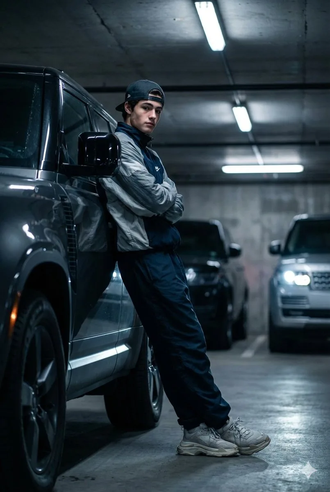

# Harboriis — by @harboriis

[← Back to Community Examples](../../EXAMPLES.md) · Category: Photography · Model: `Nano Banana`

<a href="https://x.com/harboriis/status/2011273105541644683"></a>

Source: **[@harboriis on X](https://x.com/harboriis/status/2011273105541644683)** · Creator: [Harboriis](https://x.com/harboriis)

## Prompt

```text
Hyper-realistic low-angle closeup front shot of a young man use image uploaded leaning against a Land Rover Defender in a dim basement garage.

Wearing oversized Nike wind cheater, baggy basketball pants, Adidas chunky sneakers, basketball cap. Hands crossed, attitude gaze. Luxury SUVs softly blurred with cinematic bokeh, shallow depth of field, strong subject separation, and 8K cinematic color grading.
```

## Try it

Paste the prompt into **[vinano.ai](https://vinano.ai?utm_source=github&utm_medium=readme&utm_campaign=awesome-image-video-prompts-updating&utm_content=x-page-try)** to generate your own version.

> The image and prompt belong to @harboriis ([original post](https://x.com/harboriis/status/2011273105541644683)) and are shown here with credit for reference. Creators can ask for changes or removal by opening an issue.
