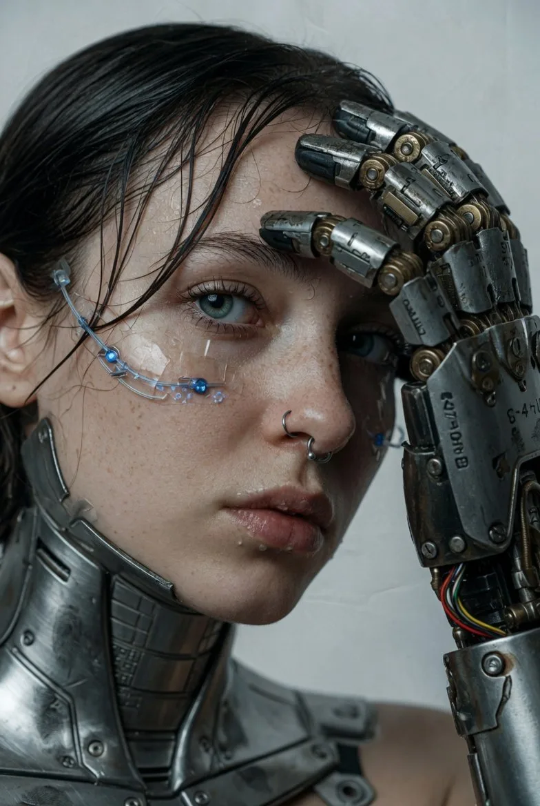

# Heisenberg — by @rovvmut_

[← Back to Community Examples](../../EXAMPLES.md) · Category: Illustration & 3D · Model: `Nano Banana`

<a href="https://x.com/rovvmut_/status/2041020925706117267"></a>

Source: **[@rovvmut_ on X](https://x.com/rovvmut_/status/2041020925706117267)** · Creator: [Heisenberg](https://x.com/rovvmut_)

## Prompt

```text
A hyper-realistic, cinematic extreme close-up portrait of a young woman with fair, freckled skin and damp, dark hair. She has striking blue-green eyes and a silver septum ring.
Cybernetic Details: A large, highly detailed mechanical prosthetic hand with weathered industrial textures, exposed wires, and hydraulic pistons is positioned near her face, with fingers curled toward her temple. 
A thin, surgical-grade cybernetic wire or sensor line runs horizontally across her cheek, just beneath her eye. 
The jawline and neck feature integrated metallic plating and brushed-steel augmentations.

Background: A minimalist, neutral studio backdrop in soft grey-white.
Lighting: Soft, directional front-left lighting that creates deep, intricate shadows within the mechanical joints and highlights the moisture on her skin and lips.
Atmosphere: Gritty, futuristic, and melancholic with a high-fashion editorial feel.
Composition: Asymmetrical framing, shallow depth of field focusing on the eye and the texture of the robotic fingers.
Texture: Hyper-detailed skin pores, fine wet hair strands, and scratched, oil-stained metal surfaces.
Color Grade: Desaturated cool tones with high contrast. High-resolution digital art/3D render style.
```

## Try it

Paste the prompt into **[vinano.ai](https://vinano.ai?utm_source=github&utm_medium=readme&utm_campaign=awesome-image-video-prompts-updating&utm_content=x-page-try)** to generate your own version.

> The image and prompt belong to @rovvmut_ ([original post](https://x.com/rovvmut_/status/2041020925706117267)) and are shown here with credit for reference. Creators can ask for changes or removal by opening an issue.
