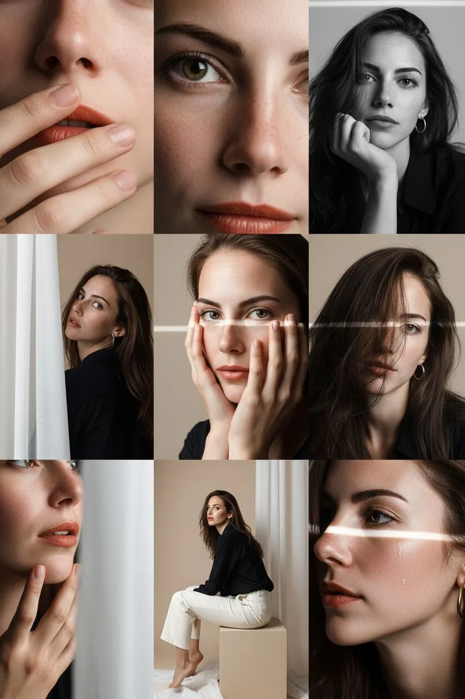

# 摆烂程序媛 — by @wanerfu

[← Back to Community Examples](../../EXAMPLES.md) · Category: Photography · Model: `Nano Banana`

<a href="https://x.com/wanerfu/status/2017116581164454309"></a>

Source: **[@wanerfu on X](https://x.com/wanerfu/status/2017116581164454309)** · Creator: [摆烂程序媛](https://x.com/wanerfu)

## Prompt

```text
在柔和米色的工作室内，构建3x3精细编辑照片网格

角色穿深蓝轻薄衬衫，米白长裤，赤脚展现原始质感

灯光设计：
前右大面积柔光，左侧银反光板，顶部微弱轮廓光。

9组精细镜头构图：
1.85mm f/1.8极致唇部特写
2.眼睛对镜特写
3.黑白下巴支撑肖像
4.半遮半露肖像
5.手覆面部特写
6.发丝遮眼构图
7.手部触下巴细节
8.半身侧坐姿势
9.带泪水的侧脸电影感
```

## Try it

Paste the prompt into **[vinano.ai](https://vinano.ai?utm_source=github&utm_medium=readme&utm_campaign=awesome-image-video-prompts-updating&utm_content=x-page-try)** to generate your own version.

> The image and prompt belong to @wanerfu ([original post](https://x.com/wanerfu/status/2017116581164454309)) and are shown here with credit for reference. Creators can ask for changes or removal by opening an issue.
