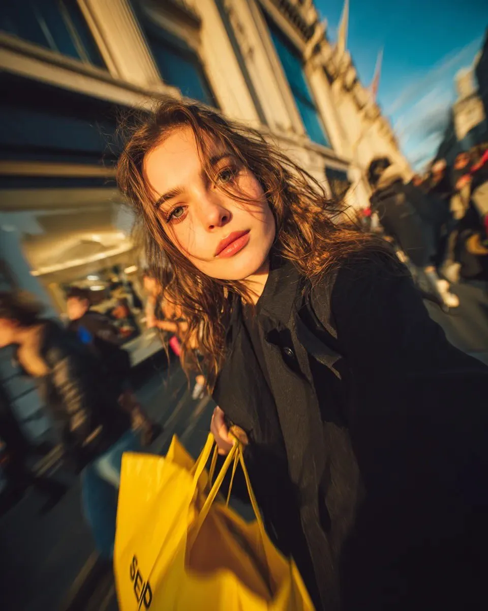

# Sairah — by @Sairah_0

[← Back to Community Examples](../../EXAMPLES.md) · Category: Photography · Model: `Nano Banana`

<a href="https://x.com/Sairah_0/status/2044616580890575125"></a>

Source: **[@Sairah_0 on X](https://x.com/Sairah_0/status/2044616580890575125)** · Creator: [Sairah](https://x.com/Sairah_0)

## Prompt

```text
Cinematic street portrait of a young woman walking through a busy shopping street at golden hour, holding bright yellow shopping bags, wind-blown wavy hair, soft natural makeup, intense eye contact with camera, shot from a slightly low angle close-up, dynamic motion blur in the background crowd, sharp focus on face, warm sunlight casting dramatic highlights and shadows, urban European architecture, shallow depth of field, 35mm lens, f/1.8, high contrast, rich warm tones, editorial fashion photography style, ultra-realistic, 8k.
```

## Try it

Paste the prompt into **[vinano.ai](https://vinano.ai?utm_source=github&utm_medium=readme&utm_campaign=awesome-image-video-prompts-updating&utm_content=x-page-try)** to generate your own version.

> The image and prompt belong to @Sairah_0 ([original post](https://x.com/Sairah_0/status/2044616580890575125)) and are shown here with credit for reference. Creators can ask for changes or removal by opening an issue.
