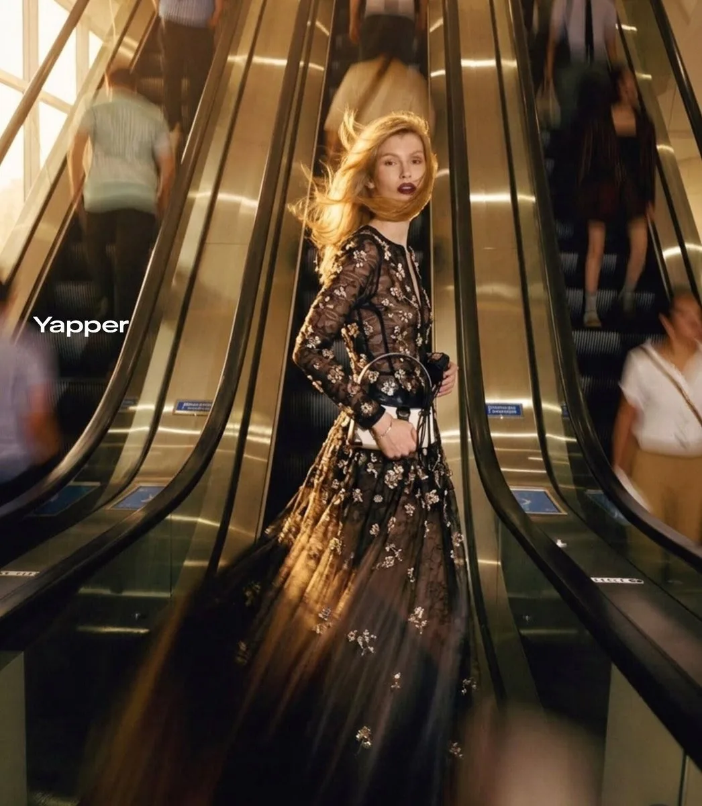

# Synthia — by @AIwithSynthia

[← Back to Examples from X](../../EXAMPLES.md) · Category: Photography · Model: `Nano Banana`

<a href="https://x.com/AIwithSynthia/status/2030443205599404475"></a>

Original post: **[@AIwithSynthia on X](https://x.com/AIwithSynthia/status/2030443205599404475)** · Creator: [Synthia](https://x.com/AIwithSynthia)

## Prompt

```text
Ultra-realistic cinematic fashion photograph of a stylish blonde woman standing confidently between two moving escalators inside a luxury shopping mall, wearing a sheer black lace long-sleeve top and flowing skirt, holding a small white designer handbag, her hair dramatically blowing sideways as if caught in motion, blurred crowd moving up and down the escalators creating dynamic motion streaks around her, she remains sharp and perfectly focused in the center, dramatic fashion editorial lighting, shallow depth of field, high contrast, Vogue magazine style, motion blur photography, symmetrical escalator composition, luxury mall interior, 85mm lens, f/1.8, ultra detailed, film grain, cinematic color grading.
```

## Try it

Paste the prompt into **[vinano.ai](https://vinano.ai?utm_source=github&utm_medium=readme&utm_campaign=awesome-image-video-prompts-updating&utm_content=x-page-try)** to generate your own version.

> The image and prompt belong to [@AIwithSynthia](https://x.com/AIwithSynthia) and are shown here with credit for reference. Creators can ask for changes or removal by opening an issue.
