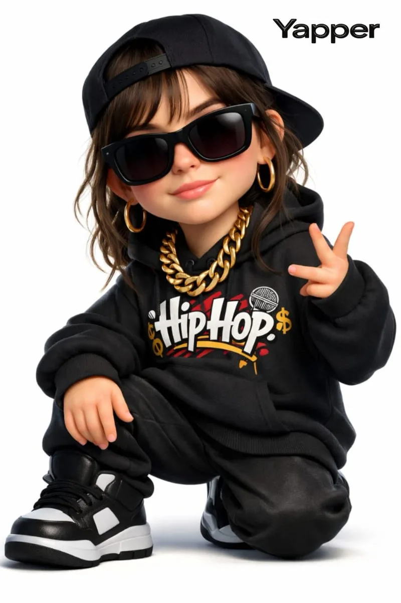

# simeon-sanai — by @Naiknelofar788

[← Back to Examples from X](../../EXAMPLES.md) · Category: Illustration & 3D · Model: `Nano Banana`

<a href="https://x.com/Naiknelofar788/status/2032026944481739045"></a>

Original post: **[@Naiknelofar788 on X](https://x.com/Naiknelofar788/status/2032026944481739045)** · Creator: [simeon-sanai](https://x.com/Naiknelofar788)

## Prompt

```text
Create a 3D cartoon-style woman with a rap style (the face is inspired by the reference image). She should have a large head and oversized sneakers, an extra-large hoodie with a rap-style print, loose black pants, big sunglasses, and a thick chain necklace. Place her in a fun pose, with a white background, cinematic lighting, and a highly detailed Pixar-style render.
```

## Try it

Paste the prompt into **[vinano.ai](https://vinano.ai?utm_source=github&utm_medium=readme&utm_campaign=awesome-image-video-prompts-updating&utm_content=x-page-try)** to generate your own version.

> The image and prompt belong to [@Naiknelofar788](https://x.com/Naiknelofar788) and are shown here with credit for reference. Creators can ask for changes or removal by opening an issue.
