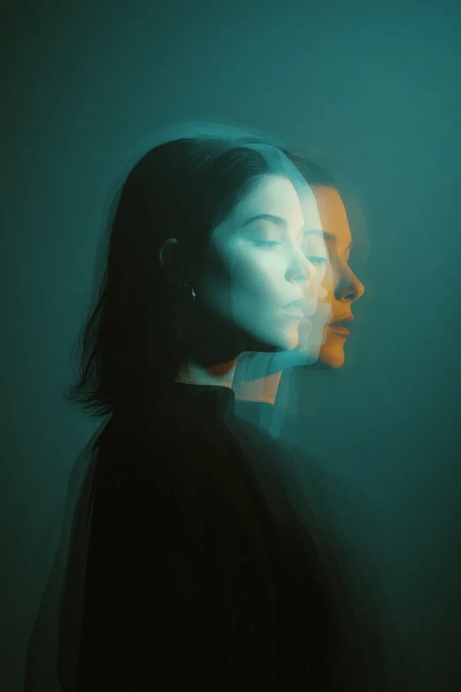

# Kashberg — by @Kashberg_0

[← Back to Community Examples](../../EXAMPLES.md) · Category: Photography · Model: `Nano Banana`

<a href="https://x.com/Kashberg_0/status/2031893424979546397"></a>

Source: **[@Kashberg_0 on X](https://x.com/Kashberg_0/status/2031893424979546397)** · Creator: [Kashberg](https://x.com/Kashberg_0)

## Prompt

```text
Cinematic double exposure portrait of a woman in side profile, two overlapping faces slightly offset, teal and orange moody lighting, soft motion blur, dark minimal background, high contrast, studio photography, dreamy atmosphere, ultra-realistic skin texture, shallow depth of field, 85mm lens, dramatic fine art portrait, volumetric lighting. 🎨
```

## Try it

Paste the prompt into **[vinano.ai](https://vinano.ai?utm_source=github&utm_medium=readme&utm_campaign=awesome-image-video-prompts-updating&utm_content=x-page-try)** to generate your own version.

> The image and prompt belong to @Kashberg_0 ([original post](https://x.com/Kashberg_0/status/2031893424979546397)) and are shown here with credit for reference. Creators can ask for changes or removal by opening an issue.
