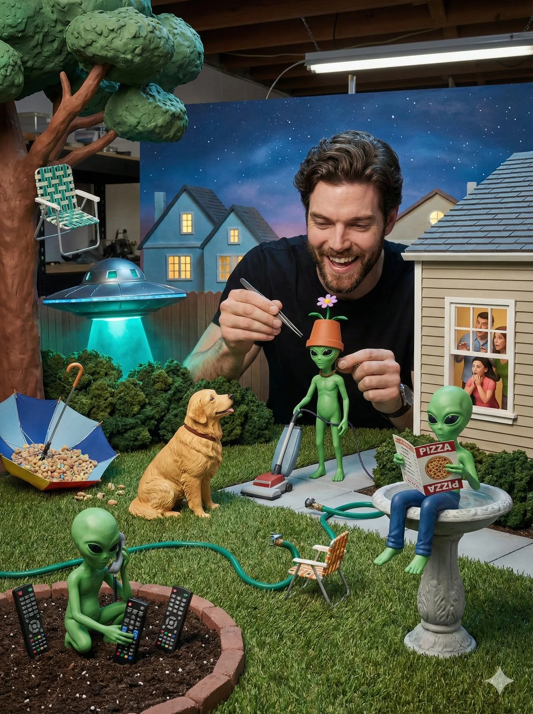

# 𝐌 — by @Strength04_X

[← Back to Examples from X](../../EXAMPLES.md) · Category: Illustration & 3D · Model: `Nano Banana`

<a href="https://x.com/Strength04_X/status/2008872906911314231"></a>

Original post: **[@Strength04_X on X](https://x.com/Strength04_X/status/2008872906911314231)** · Creator: [𝐌](https://x.com/Strength04_X)

## Prompt

```text
Professional photography, medium-wide shot. A massive, realistic diorama world filling the entire workspace horizon, depicting a cross-section of a suburban backyard where a confused alien is hilariously misusing everyday Earth objects. The structure features a typical wooden fence and garden shed merged with a UFO partially hidden behind bushes (with soft LED underglow). Intricate details include a miniature green alien figurine wearing a flower pot as a hat, attempting to "walk" a vacuum cleaner on a leash like a dog, using a garden hose as a telephone, sitting in a birdbath fully clothed reading a pizza menu upside-down, and trying to plant TV remote controls in soil like seeds. A confused golden retriever figurine watches with head tilted. On the patio, miniature human figures peek through window curtains looking shocked and bewildered. The lawn features misplaced items: umbrella stuck in ground upside-down filled with cereal, lawn chair hanging from tree branch, sprinkler shooting water straight up. The background consists entirely of physical 3D forms, featuring sculpted foam neighboring houses with lights on, clay trees, and a painted evening sky with tiny stars, with absolutely no flat backdrops. A realistic human artisan is positioned in the back-right background, actively working on the scene, using fine tweezers to adjust the tiny vacuum cleaner "leash," grinning widely at the absurdity. Dual-layer workspace lighting combines with warm evening suburban lighting plus soft UFO glow (blue-green LED) to highlight the contrast between normal suburban textures and surreal alien confusion. Compose the scene for a 9:16 vertical aspect ratio with balanced framing and no cropped elements. Ensure all primary subjects, key actions, and facial features remain within a central safe zone, avoiding edge cropping across the selected aspect ratio. If a human creator or artisan is present in the scene, render the person as a realistic individual. Use the uploaded image reference as the exact facial identity of the creator. Maintain consistent facial structure, proportions, and likeness. Do not reinterpret, stylize, or substitute the face.
```

## Try it

Paste the prompt into **[vinano.ai](https://vinano.ai?utm_source=github&utm_medium=readme&utm_campaign=awesome-image-video-prompts-updating&utm_content=x-page-try)** to generate your own version.

> The image and prompt belong to [@Strength04_X](https://x.com/Strength04_X) and are shown here with credit for reference. Creators can ask for changes or removal by opening an issue.
