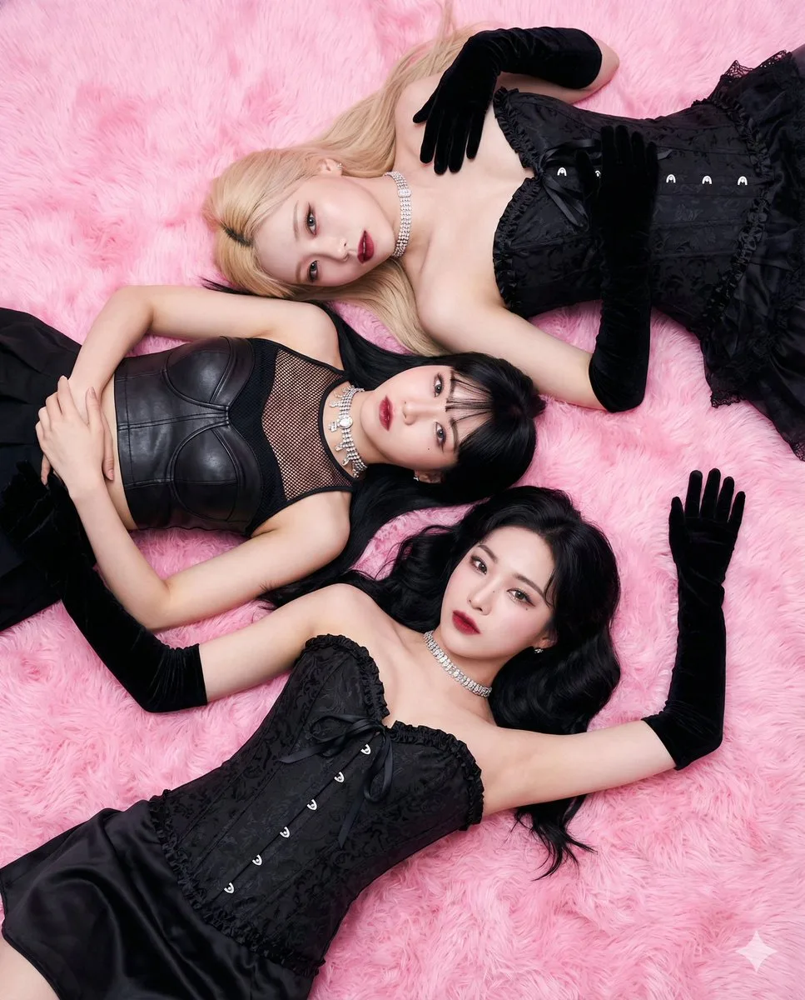

# Iqra Saifi — by @IqraSaifiii

[← Back to Examples from X](../../EXAMPLES.md) · Category: Photography · Model: `Nano Banana`

<a href="https://x.com/IqraSaifiii/status/2011117557391225023"></a>

Original post: **[@IqraSaifiii on X](https://x.com/IqraSaifiii/status/2011117557391225023)** · Creator: [Iqra Saifi](https://x.com/IqraSaifiii)

## Prompt

```text
{
  "scene_description": "Three young women lying down on a textured surface. The bodies are intertwined in a triangular composition.",
  "background": "Plush, high-pile bright pink faux fur rug or fabric.",
  "subject_details": {
    "demographics": "Three young Asian women (K-pop idol aesthetic), pale skin tones.",
    "styling_theme": "Gothic Lolita / Dark Coquette / Black on Pink.",
    "makeup": "Consistent across all three: dark red gradient lips, soft smoky eye makeup, defined brows.",
    "subject_1_top": {
      "position": "Lying horizontally at the top.",
      "hair": "Blonde, long wavy hair.",
      "outfit": "Black corset top with ruffled straps, black velvet opera gloves, crystal choker necklace."
    },
    "subject_2_middle_right": {
      "position": "Lying diagonally below Subject 1, head resting near Subject 1's shoulder.",
      "hair": "Black, long straight hair.",
      "outfit": "Black leather/latex bustier top with sheer mesh panel, crystal collar necklace."
    },
    "subject_3_bottom_center": {
      "position": "Lying vertically in the foreground, head resting near Subject 2's chest.",
      "hair": "Black, long wavy hair.",
      "outfit": "Black brocade corset with lace trim, black opera gloves, black satin skirt, crystal choker.",
      "pose": "Arms extended upwards and outwards, framing the composition."
    }
  },
  "exact_pose_anatomical": {
    "viewpoint": "Bird's-eye view (Directly overhead).",
    "heads": "All three faces are angled upwards towards the camera lens.",
    "eyes": "Direct eye contact from all subjects.",
    "limbs": "Arms are positioned to create leading lines; Subject 3's gloved arms reach up towards the other two."
  },
  "camera_technical_values": {
    "angle": "90-degree Top Down.",
    "focal_length": "50mm (Standard lens to capture the group without wide-angle distortion).",
    "aperture": "f/5.6 (To ensure all three faces, which are on slightly different planes, are in sharp focus).",
    "shutter_speed": "1/125s (Studio setting).",
    "iso": "ISO 100 (Clean image quality).",
    "framing": "Tight framing, filling the canvas with the subjects and the pink texture."
  },
  "lighting_setup": {
    "type": "Soft Studio Lighting (Beauty Dish or Softbox).",
    "direction": "Frontal/Overhead (relative to the camera).",
    "quality": "Even, shadowless illumination on the faces ('Butterfly lighting').",
    "contrast": "High contrast between the jet-black outfits and the bright pink background/pale skin.",
    "highlights": "Soft specular highlights on the black leather and latex textures."
  }
}
```

## Try it

Paste the prompt into **[vinano.ai](https://vinano.ai?utm_source=github&utm_medium=readme&utm_campaign=awesome-image-video-prompts-updating&utm_content=x-page-try)** to generate your own version.

> The image and prompt belong to [@IqraSaifiii](https://x.com/IqraSaifiii) and are shown here with credit for reference. Creators can ask for changes or removal by opening an issue.
