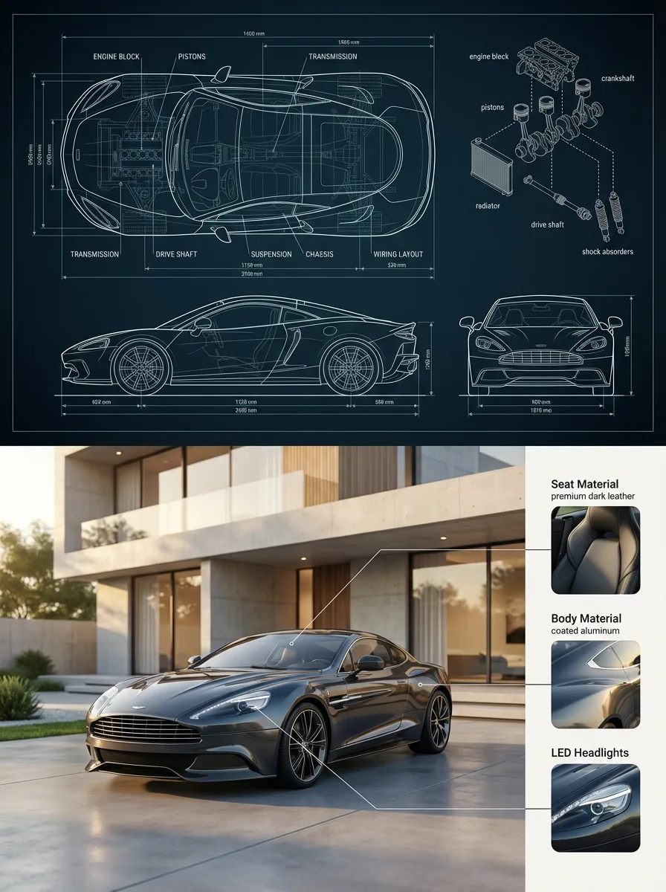

# Keskin — by @craftian_keskin

[← Back to Community Examples](../../EXAMPLES.md) · Category: UI & Graphic · Model: `Nano Banana`

<a href="https://x.com/craftian_keskin/status/2039777786639126806"></a>

Source: **[@craftian_keskin on X](https://x.com/craftian_keskin/status/2039777786639126806)** · Creator: [Keskin](https://x.com/craftian_keskin)

## Prompt

```text
{
  "objective": "Create a premium split composition showing a detailed automotive blueprint (top) and a perfectly matching real-world car with material breakdown (bottom), with a carefully designed high-end background",
  "aspect_ratio": "3:4",
  "composition": {
    "layout": "vertical_split",
    "split_ratio": "50:50",
    "alignment": "precise, centered",
    "continuity_rule": "bottom car must EXACTLY match blueprint geometry, proportions, and design"
  },

  "top_section": {
    "type": "engineering_blueprint",
    "style": "ultra-detailed CAD drawing",
    "background": {
      "color": "#0b1d2a",
      "texture": "subtle grid lines",
      "vignette": "very slight edge darkening"
    },
    "linework": {
      "color": "white with faint cyan glow",
      "thickness_variation": "technical precision",
      "sharpness": "very crisp"
    },
    "views": {
      "top_view": "dominant center",
      "side_view": "bottom left",
      "front_view": "bottom right"
    },
    "technical_elements": {
      "dimension_lines": true,
      "units": "mm",
      "arrows": "thin CAD arrows",
      "labels": [
        "ENGINE BLOCK",
        "PISTONS",
        "TRANSMISSION",
        "DRIVE SHAFT",
        "SUSPENSION",
        "CHASSIS",
        "WIRING LAYOUT"
      ],
      "exploded_diagram": {
        "position": "top right",
        "components": [
          "engine block",
          "crankshaft",
          "pistons",
          "radiator",
          "drive shaft",
          "shock absorbers"
        ],
        "connection_lines": "dashed white"
      }
    },
    "detail_level": "engineering-grade, extremely dense"
  },

  "bottom_section": {
    "type": "real_product + material_breakdown",
    "layout": "car_left_material_panel_right",

    "environment": {
      "type": "luxury architectural setting",
      "design_intent": "background must feel intentional, premium, and editorial — not random",

      "scene": {
        "location": "modern minimalist luxury house exterior",
        "architecture": [
          "clean concrete walls",
          "large floor-to-ceiling glass panels",
          "subtle wood accents",
          "sharp geometric lines"
        ],
        "ground": "smooth concrete driveway with slight reflection",
        "background_elements": [
          "minimal landscaping (bonsai-style trees or trimmed bushes)",
          "no clutter",
          "balanced negative space"
        ]
      },

      "lighting": {
        "time": "golden hour (soft warm sunlight)",
        "direction": "side lighting to enhance car shape",
        "shadows": "soft and elongated",
        "reflections": "physically accurate on car paint"
      },

      "depth": {
        "depth_of_field": "moderate",
        "background_blur": "slight cinematic blur",
        "focus_priority": "car remains razor sharp"
      }
    },

    "car_render": {
      "style": "photorealistic automotive photography",
      "camera": {
        "angle": "3/4 front angle",
        "height": "slightly low for hero perspective",
        "lens": "35mm",
        "framing": "car occupies left 60% of bottom section"
      },
      "constraints": [
        "exact match to blueprint",
        "no added design features",
        "realistic proportions only"
      ]
    },

    "material_panel": {
      "position": "right side",
      "style": "Apple-style product breakdown",
      "background": "soft off-white panel with subtle shadow separation",
      "layout": "vertical stack with spacing",

      "items": [
        {
          "title": "Seat Material",
          "visual": "macro close-up of seat texture",
          "material": "premium leather or fabric",
          "lighting": "soft diffused",
          "annotation": "thin line pointing to interior seat"
        },
        {
          "title": "Body Material",
          "visual": "close-up of painted metal with reflections",
          "material": "coated aluminum / steel",
          "annotation": "points to car exterior panel"
        },
        {
          "title": "LED Headlights",
          "visual": "detailed glowing LED headlight close-up",
          "material": "modern LED system",
          "annotation": "points to front headlight"
        }
      ],

      "typography": {
        "font": "modern sans-serif",
        "style": "clean, minimal",
        "hierarchy": "clear titles + small labels"
      }
    }
  },

  "style": {
    "fusion": [
      "engineering blueprint",
      "luxury automotive ad",
      "product design presentation"
    ],
    "quality": "ultra high-end",
    "finish": "polished, editorial-grade"
  },

  "negative_constraints": [
    "no mismatch between blueprint and car",
    "no messy or cluttered background",
    "no unrealistic reflections",
    "no over-saturated colors",
    "no random environments",
    "no extra parts not in blueprint"
  ],

  "render_settings": {
    "sharpness": "high",
    "dynamic_range": "wide",
    "color_grading": "natural cinematic",
    "noise": "minimal"
  }
}
```

## Try it

Paste the prompt into **[vinano.ai](https://vinano.ai?utm_source=github&utm_medium=readme&utm_campaign=awesome-image-video-prompts-updating&utm_content=x-page-try)** to generate your own version.

> The image and prompt belong to @craftian_keskin ([original post](https://x.com/craftian_keskin/status/2039777786639126806)) and are shown here with credit for reference. Creators can ask for changes or removal by opening an issue.
