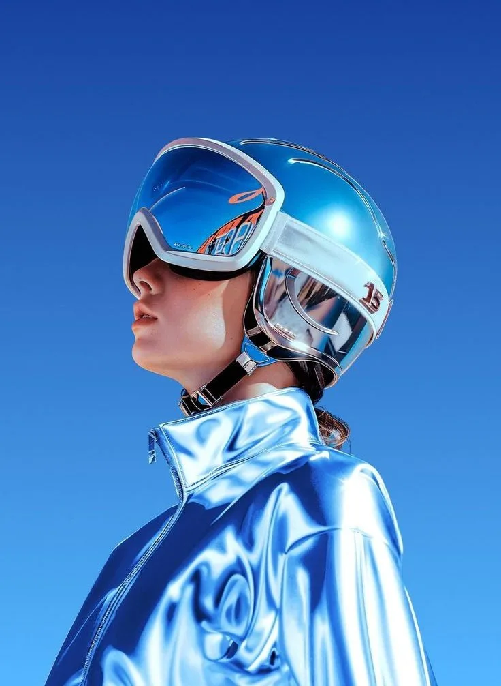

# auqib — by @auqibhabib

[← Back to Community Examples](../../EXAMPLES.md) · Category: Illustration & 3D · Model: `Nano Banana`

<a href="https://x.com/auqibhabib/status/2042461948336595020"></a>

Source: **[@auqibhabib on X](https://x.com/auqibhabib/status/2042461948336595020)** · Creator: [auqib](https://x.com/auqibhabib)

## Prompt

```text
Ultra-realistic futuristic portrait of a young woman in side profile facing left, wearing a reflective metallic blue chrome jacket and a sleek sci-fi helmet with a large glossy visor covering her eyes. The helmet has smooth curves, white accents, and transparent side panels with subtle mechanical details. The visor reflects light with a blue tint, giving a cyberpunk / space-age aesthetic. Minimalistic composition with a solid gradient blue background. Soft cinematic lighting with high contrast and glossy reflections on the jacket and helmet. Sharp focus on the face and textures, shallow depth of field, studio-quality, 8K, hyper-detailed, clean and modern fashion editorial style.
```

## Try it

Paste the prompt into **[vinano.ai](https://vinano.ai?utm_source=github&utm_medium=readme&utm_campaign=awesome-image-video-prompts-updating&utm_content=x-page-try)** to generate your own version.

> The image and prompt belong to @auqibhabib ([original post](https://x.com/auqibhabib/status/2042461948336595020)) and are shown here with credit for reference. Creators can ask for changes or removal by opening an issue.
