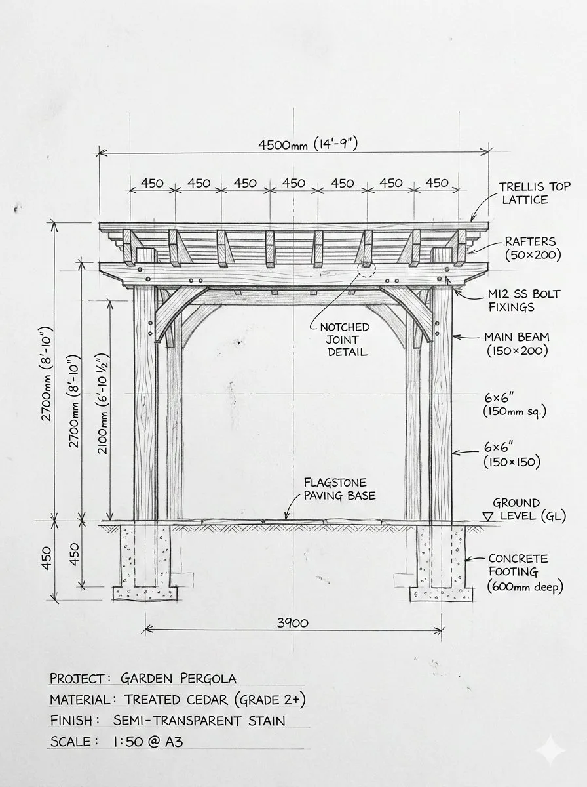

# 𝐌 — by @Strength04_X

[← Back to Examples from X](../../EXAMPLES.md) · Category: UI & Graphic · Model: `Nano Banana`

<a href="https://x.com/Strength04_X/status/2027936240985903452"></a>

Original post: **[@Strength04_X on X](https://x.com/Strength04_X/status/2027936240985903452)** · Creator: [𝐌](https://x.com/Strength04_X)

## Prompt

```text
Pergola Blueprint Prompt: Hand-drawn architectural pencil sketch of a wooden garden pergola on white paper. Front and slight side elevation view with clear proportions.

Construction lines, dimensions and handwritten notes visible. Wooden posts and cross beams precisely drafted. Professional but hand-sketched technical style. Clean white background.

Finished Pergola: Fully built wooden pergola in a real garden, matching the exact structure and proportions from the sketch. Viewed from a low front corner perspective at eye level, showing depth and the full beam structure instead of a flat elevation. Natural wood texture with realistic joints and connections. Installed on grass with surrounding plants. Soft daylight with grounded shadows. Photorealistic architectural visualization.
```

## Try it

Paste the prompt into **[vinano.ai](https://vinano.ai?utm_source=github&utm_medium=readme&utm_campaign=awesome-image-video-prompts-updating&utm_content=x-page-try)** to generate your own version.

> The image and prompt belong to [@Strength04_X](https://x.com/Strength04_X) and are shown here with credit for reference. Creators can ask for changes or removal by opening an issue.
