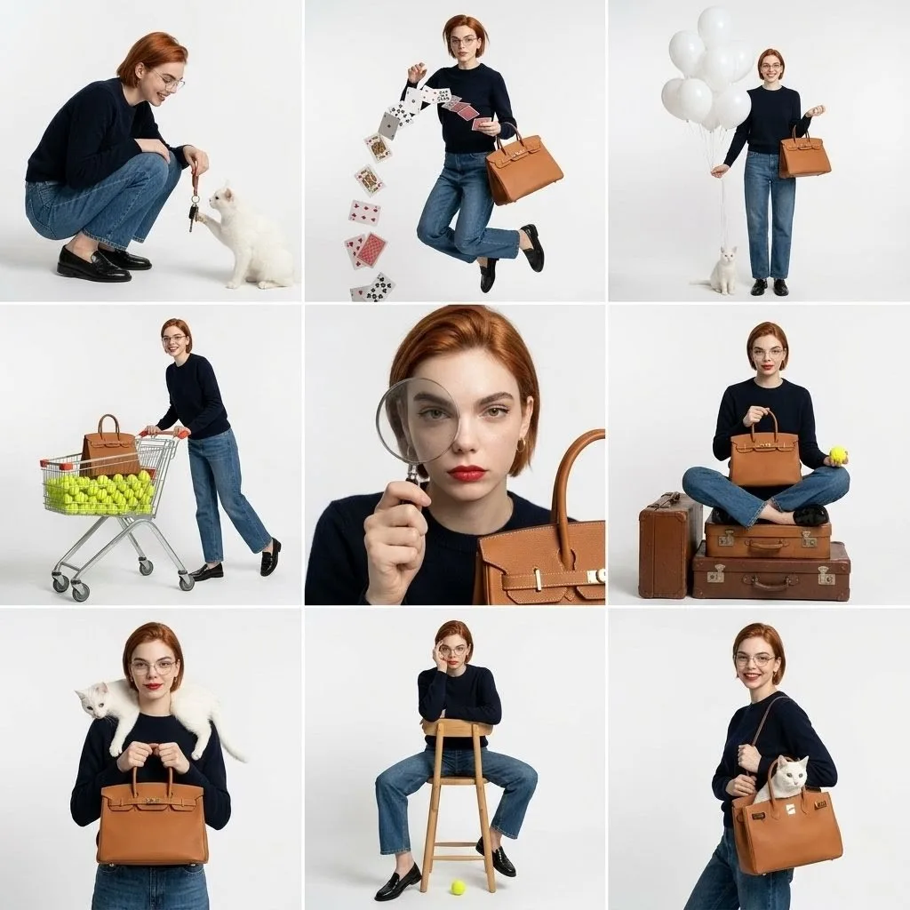

# Synthia — by @AIwithSynthia

[← Back to Examples from X](../../EXAMPLES.md) · Category: Photography · Model: `Nano Banana`

<a href="https://x.com/AIwithSynthia/status/2044780006812110949"></a>

Original post: **[@AIwithSynthia on X](https://x.com/AIwithSynthia/status/2044780006812110949)** · Creator: [Synthia](https://x.com/AIwithSynthia)

## Prompt

```text
studio fashion collage, 3x3 grid layout, same subject repeated in different poses across all panels, clean seamless white background, soft diffused studio lighting, minimalist aesthetic, playful editorial storytelling
subject styled in smart casual outfit (navy sweater, relaxed denim, glasses, polished shoes), holding and interacting with a structured luxury handbag as the central prop, quirky narrative scenes in each frame:
top row — crouching and interacting with a white cat beside handbag, tossing playing cards mid-air while holding bag, standing holding a bunch of white balloons
middle row — pushing a shopping cart filled with bright tennis balls, close-up portrait using a magnifying glass toward camera, sitting on stacked vintage suitcases holding handbag with a tennis ball
bottom row — standing with cat draped over shoulders holding bag, sitting backwards on a wooden chair with tennis ball under chair, standing pose with cat sitting inside handbag
consistent styling across all frames, balanced composition, symmetrical spacing, editorial grid layout, subtle humor and surreal elements, crisp sharp focus, high fashion campaign vibe, photorealistic, ultra clean shadows, 50mm lens look, f2.0
```

## Try it

Paste the prompt into **[vinano.ai](https://vinano.ai?utm_source=github&utm_medium=readme&utm_campaign=awesome-image-video-prompts-updating&utm_content=x-page-try)** to generate your own version.

> The image and prompt belong to [@AIwithSynthia](https://x.com/AIwithSynthia) and are shown here with credit for reference. Creators can ask for changes or removal by opening an issue.
