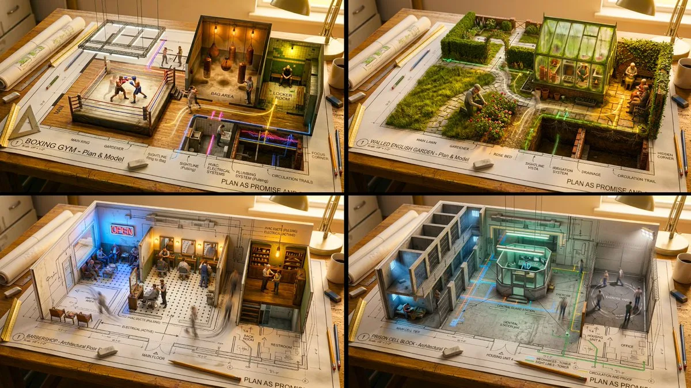

# TechieSA — by @TechieBySA

[← Back to Community Examples](../../EXAMPLES.md) · Category: Illustration & 3D · Model: `Nano Banana`

<a href="https://x.com/TechieBySA/status/2032193497898336334"></a>

Source: **[@TechieBySA on X](https://x.com/TechieBySA/status/2032193497898336334)** · Creator: [TechieSA](https://x.com/TechieBySA)

## Prompt

```text
An architectural floor plan of a [LOCATION] spread across a drafting table, with the spaces rising into inhabitable miniature. The [ROOM 1] emerges with worn materials and weathered surfaces and a solitary figure deep in task under warm amber practical light in progress, the [ROOM 2] rises with contrasting textures and layered detail and two people sharing a human moment under cool contrasting light casting coloured shadows across the walls, the [ROOM 3] pushes up with intimate scale and personal objects and a quiet figure in stillness under a single practical light source casting a warm pool across the floor. The floor material on the plan becomes actual surface underfoot. Walls exist as both lines and actual partitions simultaneously. Sight lines marked on the plan become actual views between spaces. The mechanical systems in the plan, HVAC, plumbing, electrical, pulse with invisible function. Human circulation patterns appear as ghosted movement trails. Architectural scale figures become actual tiny inhabitants living their tiny lives. Section cuts reveal vertical relationships. The architect’s tools surround: scales, pencils, trace paper. Golden design studio light, the plan as promise and proof, 8K, architecture as life container.
```

## Try it

Paste the prompt into **[vinano.ai](https://vinano.ai?utm_source=github&utm_medium=readme&utm_campaign=awesome-image-video-prompts-updating&utm_content=x-page-try)** to generate your own version.

> The image and prompt belong to @TechieBySA ([original post](https://x.com/TechieBySA/status/2032193497898336334)) and are shown here with credit for reference. Creators can ask for changes or removal by opening an issue.
