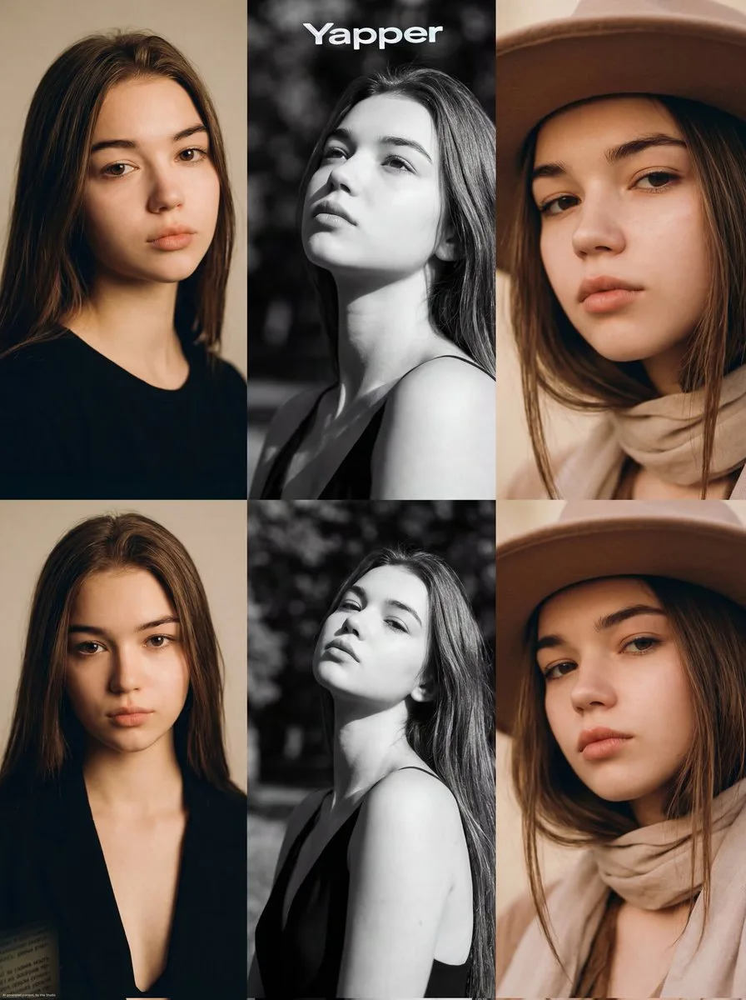

# 𝗦𝗮𝗻𝗶𝗮 — by @saniaspeaks_

[← Back to Community Examples](../../EXAMPLES.md) · Category: Photography · Model: `Nano Banana`

<a href="https://x.com/saniaspeaks_/status/2030972409637982607"></a>

Source: **[@saniaspeaks_ on X](https://x.com/saniaspeaks_/status/2030972409637982607)** · Creator: [𝗦𝗮𝗻𝗶𝗮](https://x.com/saniaspeaks_)

## Prompt

```text
{
  "type": "image_generation_prompt",
  "style": "ultra-realistic editorial fashion photography, Vogue-style",
  "resolution": "8K HDR",
  "aspect_ratio": "3:1",
  "composition": {
    "layout": "3x1 horizontal grid",
    "description": "three-panel editorial portrait composition featuring the same person in different artistic styles",
    "symmetry": "balanced spacing and clean alignment across all panels"
  },
  "identity_preservation": {
    "gender": "female",
    "use_reference_image": true,
    "strict_identity_lock": true,
    "notes": "Maintain the exact facial features, skin tone, hair type, and natural proportions from the uploaded reference photo."
  },
  "panels": [
    {
      "position": "left",
      "style": "studio portrait",
      "environment": {
        "background": "neutral minimalist studio backdrop"
      },
      "lighting": "soft studio lighting with cinematic face illumination",
      "clothing": "minimalist black or neutral turtleneck",
      "expression": "calm and confident",
      "focus": "sharp focus on the face with shallow depth of field",
      "color_grading": "magazine-quality tones"
    },
    {
      "position": "center",
      "style": "black and white artistic portrait",
      "environment": {
        "location": "outdoor setting",
        "background": "tree shadows and natural light patterns"
      },
      "camera_angle": "dynamic upward angle",
      "lighting": "natural sunlight creating dramatic contrast",
      "expression": "elegant and dramatic",
      "color_mode": "monochrome black and white",
      "focus": "high detail on facial structure and hair"
    },
    {
      "position": "right",
      "style": "fashion close-up",
      "environment": {
        "background": "soft warm-toned backdrop"
      },
      "accessories": [
        "wide fashionable hat or elegant scarf"
      ],
      "lighting": "soft warm lighting enhancing facial features",
      "details": "delicate fabric textures and sharp detail on eyes and skin",
      "expression": "stylish, confident, slightly intense"
    }
  ],
  "visual_style": {
    "aesthetic": "high-end fashion editorial",
    "lighting": "cinematic lighting across panels",
    "depth_of_field": "shallow",
    "textures": "photorealistic skin and fabric textures",
    "color_transition": "smooth transitions between frames",
    "finish": "glossy magazine look"
  },
  "constraints": [
    "no facial alterations",
    "no cartoon style",
    "no distortions",
    "no watermark",
    "no text overlays"
  ],
  "output_goal": "Create a cohesive 3x1 editorial portrait grid of the same woman in three distinct fashion photography styles with ultra-realistic detail and cinematic lighting."
}
```

## Try it

Paste the prompt into **[vinano.ai](https://vinano.ai?utm_source=github&utm_medium=readme&utm_campaign=awesome-image-video-prompts-updating&utm_content=x-page-try)** to generate your own version.

> The image and prompt belong to @saniaspeaks_ ([original post](https://x.com/saniaspeaks_/status/2030972409637982607)) and are shown here with credit for reference. Creators can ask for changes or removal by opening an issue.
