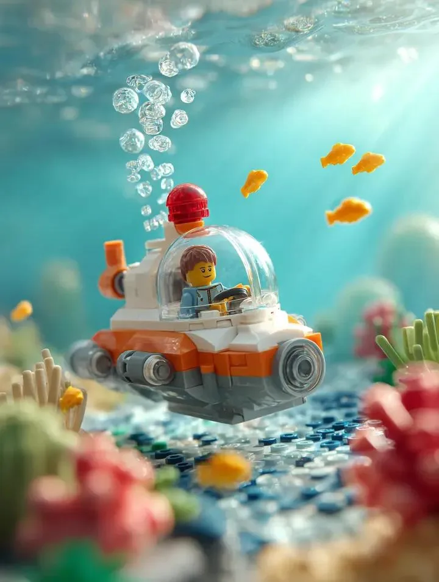

# 𝐌 — by @Strength04_X

[← Back to Community Examples](../../EXAMPLES.md) · Category: Illustration & 3D · Model: `Nano Banana`

<a href="https://x.com/Strength04_X/status/2033996156225917017"></a>

Source: **[@Strength04_X on X](https://x.com/Strength04_X/status/2033996156225917017)** · Creator: [𝐌](https://x.com/Strength04_X)

## Prompt

```text
Surrounding the submarine are multiple small bright yellow LEGO fish swimming at different depths, with several air bubbles rising upward in sharp detail. The seabed is made of LEGO bricks, including textured sand, blue tiles, and colorful coral elements in red, green, and yellow. The water is clear turquoise with soft light rays filtering from above, creating realistic underwater caustics and reflections.

Shallow depth of field (f/1.8), strong bokeh background, 50mm lens, ultra-realistic lighting, vibrant colors, high detail, professional macro photography style.
```

## Try it

Paste the prompt into **[vinano.ai](https://vinano.ai?utm_source=github&utm_medium=readme&utm_campaign=awesome-image-video-prompts-updating&utm_content=x-page-try)** to generate your own version.

> The image and prompt belong to @Strength04_X ([original post](https://x.com/Strength04_X/status/2033996156225917017)) and are shown here with credit for reference. Creators can ask for changes or removal by opening an issue.
