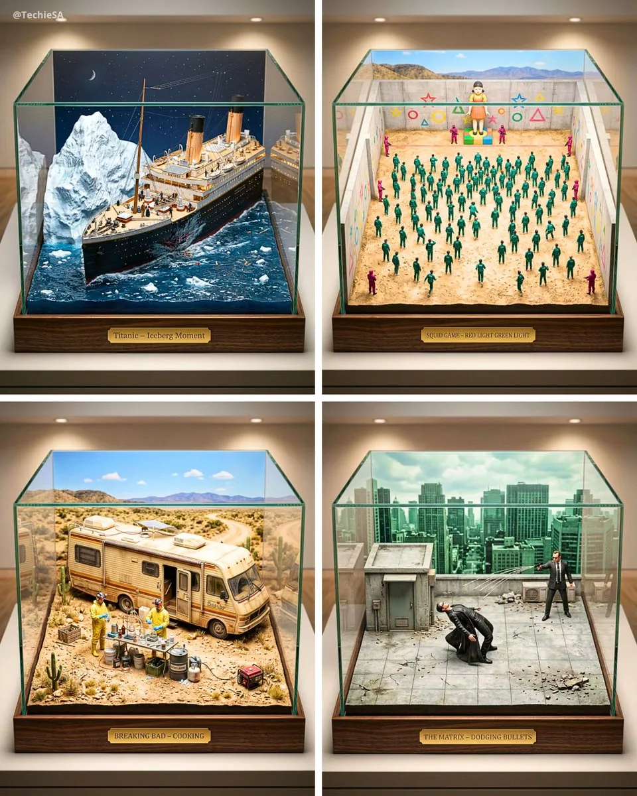

# TechieSA — by @TechieBySA

[← Back to Examples from X](../../EXAMPLES.md) · Category: Illustration & 3D · Model: `Nano Banana`

<a href="https://x.com/TechieBySA/status/2031083876005576937"></a>

Original post: **[@TechieBySA on X](https://x.com/TechieBySA/status/2031083876005576937)** · Creator: [TechieSA](https://x.com/TechieBySA)

## Prompt

```text
Ultra-detailed large-scale miniature diorama of the [ICONIC SCENE] from [MOVIE/SHOW] presented as a premium museum-quality desktop exhibition model.
True scale model craftsmanship with extreme fine detail.
[ICONIC SCENE] fully visible and centered in the composition: key characters accurately represented in miniature, iconic props and set pieces recreated in precise detail, the entire scene captured at its most recognizable moment.
Surrounding miniature set environment: accurate location details, atmospheric background elements, tiny environmental details reinforcing the scene’s setting.
Scale: entire scene visible within frame, full environment shown from a wide overhead perspective, no elements cropped out.
Ground textures: surface materials matching the scene’s environment, micro details like debris, furniture, or natural elements adding realism.
Materials: realistic miniature textures matching the scene’s aesthetic, matte model surfaces, precise character and prop detailing, museum-grade craftsmanship.
Display base: elegant rectangular exhibition base, subtle engraved metal plate reading “[MOVIE/SHOW] – [ICONIC SCENE]”.
Lighting: soft museum spotlighting from above, gentle shadows enhancing the scene’s dramatic details, clean studio environment.
Camera: wide elevated bird’s-eye overview angle showing the entire diorama from above, tilt-shift miniature aesthetic, full scene visible from edge to edge, center extremely sharp with slight edge depth falloff, no close-up cropping.
Ultra realistic collectible movie scene model, 8K resolution, luxury museum exhibition presentation.
Aspect ratio 4:5 vertical.​​​​​​​​​​​​​​​​
```

## Try it

Paste the prompt into **[vinano.ai](https://vinano.ai?utm_source=github&utm_medium=readme&utm_campaign=awesome-image-video-prompts-updating&utm_content=x-page-try)** to generate your own version.

> The image and prompt belong to [@TechieBySA](https://x.com/TechieBySA) and are shown here with credit for reference. Creators can ask for changes or removal by opening an issue.
