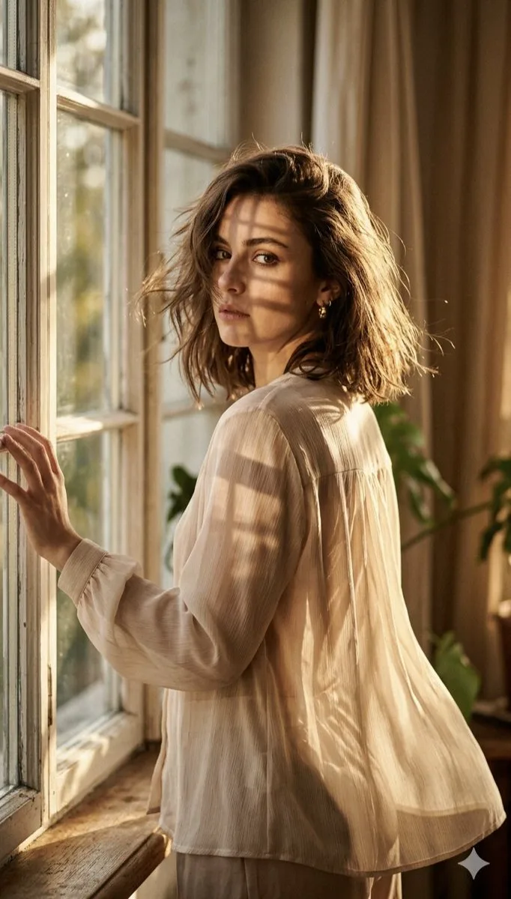

# Minahil — by @Minahil42298354

[← Back to Examples from X](../../EXAMPLES.md) · Category: Photography · Model: `Nano Banana`

<a href="https://x.com/Minahil42298354/status/2043336493419123094"></a>

Original post: **[@Minahil42298354 on X](https://x.com/Minahil42298354/status/2043336493419123094)** · Creator: [Minahil](https://x.com/Minahil42298354)

## Prompt

```text
A high-fashion editorial portrait of a young woman standing by a large, rustic wooden window. She is captured in a candid, over-the-shoulder gaze, looking directly into the camera with a soft, natural expression. One hand is gently resting on the window frame.

​Lighting & Atmosphere:

The scene is defined by golden hour sunlight streaming through the window, creating a dramatic "blind shadow" or shutter-effect across her face and blouse. The lighting is warm and high-contrast, with a hazy, ethereal atmosphere that emphasizes a quiet, "Film Noir" mood in a modern setting.

​Wardrobe & Style:

She is wearing a translucent, pleated silk chiffon blouse in a muted champagne tone. The fabric is light and airy, catching the backlighting to create a soft glow. Her hair is styled in a tousled, effortless bob with natural texture.

​Technical Specifications:

​Lens: Shot on 85mm f/1.4 for a shallow depth of field.

​Focus: Sharp focus on the eyes with a creamy, soft bokeh background featuring indoor plants and warm interior tones.

​Quality: 8K resolution, cinematic color grading, fine grain, professional photography.
```

## Try it

Paste the prompt into **[vinano.ai](https://vinano.ai?utm_source=github&utm_medium=readme&utm_campaign=awesome-image-video-prompts-updating&utm_content=x-page-try)** to generate your own version.

> The image and prompt belong to [@Minahil42298354](https://x.com/Minahil42298354) and are shown here with credit for reference. Creators can ask for changes or removal by opening an issue.
