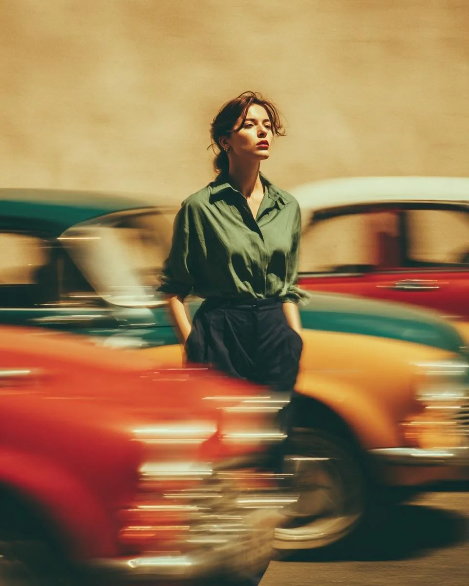

# Taaruk — by @Taaruk_

[← Back to Examples from X](../../EXAMPLES.md) · Category: Photography · Model: `Nano Banana`

<a href="https://x.com/Taaruk_/status/2015263403393355980"></a>

Original post: **[@Taaruk_ on X](https://x.com/Taaruk_/status/2015263403393355980)** · Creator: [Taaruk](https://x.com/Taaruk_)

## Prompt

```text
{
  "image_generation_prompt": {
    "subject": {
      "description": "Stylish woman",
      "expression": "calm and confident",
      "pose": "standing still, hands in pockets",
      "attire": {
        "top": "loose sage-green button-up shirt, tucked in",
        "bottom": "high-waisted dark trousers"
      }
    },
    "scene_dynamics": {
      "action": "vintage cars rushing past at high speed",
      "effect": "dramatic motion blur trails, long-exposure photography effect, dynamic motion contrast"
    },
    "environment": {
      "setting": "Street portrait",
      "atmosphere": "nostalgic, busy but focused"
    },
    "lighting_and_color": {
      "lighting": "warm golden-hour lighting",
      "color_palette": "muted retro palette",
      "accents": "reds, teals, and yellows streaking across the frame"
    },
    "technical_specifications": {
      "focus": "strong subject isolation, sharp focus on the woman, shallow depth of field",
      "style": "cinematic realism, editorial fashion mood, nostalgic 1970s film look",
      "texture": "soft grain, ultra-detailed",
      "resolution": "high resolution"
    }
  }
}
```

## Try it

Paste the prompt into **[vinano.ai](https://vinano.ai?utm_source=github&utm_medium=readme&utm_campaign=awesome-image-video-prompts-updating&utm_content=x-page-try)** to generate your own version.

> The image and prompt belong to [@Taaruk_](https://x.com/Taaruk_) and are shown here with credit for reference. Creators can ask for changes or removal by opening an issue.
