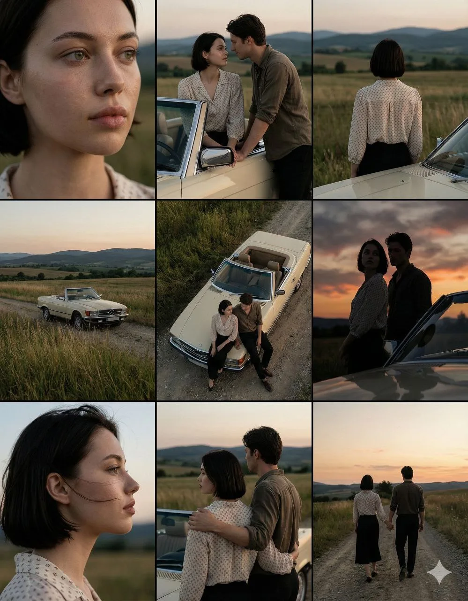

# Synthia — by @AIwithSynthia

[← Back to Examples from X](../../EXAMPLES.md) · Category: Photography · Model: `Nano Banana`

<a href="https://x.com/AIwithSynthia/status/2009855866582003777"></a>

Original post: **[@AIwithSynthia on X](https://x.com/AIwithSynthia/status/2009855866582003777)** · Creator: [Synthia](https://x.com/AIwithSynthia)

## Prompt

```text
A cinematic 3×3 grid of film-still frames featuring the same couple during a quiet countryside road stop at dusk. A young woman with short dark hair wearing a light patterned blouse stands beside a cream vintage convertible on a rural dirt road, open fields and rolling hills stretching into the distance. Each frame here shows a distinct cinematic angle: extreme close-up of her face with natural skin texture, intimate medium shot of the couple leaning on the car, back view of the woman facing the landscape, wide establishing shot with the car in tall grass, high-angle top-down shot of the couple beside the convertible, dramatic low-angle portrait against the sky, clean side profile close-up, three-quarter rear view of the couple near the car, and a full back view of them walking away hand in hand down the road. Soft natural dusk lighting, muted earthy tones, realistic colors, shallow depth of field, subtle film grain, consistent facial features across all frames, emotional cinematic mood, professional cinematography reference sheet style, ultra-realistic photography.
```

## Try it

Paste the prompt into **[vinano.ai](https://vinano.ai?utm_source=github&utm_medium=readme&utm_campaign=awesome-image-video-prompts-updating&utm_content=x-page-try)** to generate your own version.

> The image and prompt belong to [@AIwithSynthia](https://x.com/AIwithSynthia) and are shown here with credit for reference. Creators can ask for changes or removal by opening an issue.
