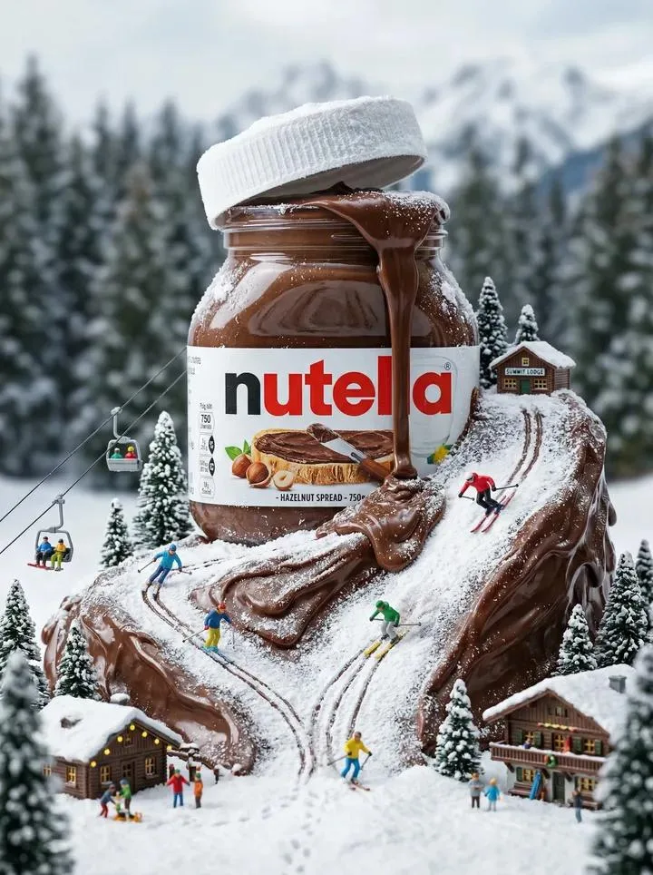

# 𝐌 — by @Strength04_X

[← Back to Examples from X](../../EXAMPLES.md) · Category: Food & Drink · Model: `Nano Banana`

<a href="https://x.com/Strength04_X/status/2029194313784016901"></a>

Original post: **[@Strength04_X on X](https://x.com/Strength04_X/status/2029194313784016901)** · Creator: [𝐌](https://x.com/Strength04_X)

## Prompt

```text
{
  "cinematic miniature winter world built around a giant Nutella jar, thick chocolate hazelnut spread flowing out forming a glossy mountain ski slope, tiny skiers skiing down the chocolate hill covered with light snow powder, miniature alpine village with wooden cabins and pine trees, ski lift with small gondolas carrying people, snowy forest background and distant mountains, soft winter lighting, ultra realistic textures of melting chocolate and snow, macro tilt shift photography, fantasy food landscape, commercial food advertising style, highly detailed, 8k",
  "negative_prompt": "blurry, low resolution, distorted jar, incorrect logo, messy composition, unrealistic proportions, extra limbs, duplicate people",
  "aspect_ratio": "4:5",
  "style": "ultra realistic macro photography",
  "lighting": "soft cinematic winter daylight",
  "camera": "macro lens, tilt shift effect",
  "quality": "high detail, 8k"
}
```

## Try it

Paste the prompt into **[vinano.ai](https://vinano.ai?utm_source=github&utm_medium=readme&utm_campaign=awesome-image-video-prompts-updating&utm_content=x-page-try)** to generate your own version.

> The image and prompt belong to [@Strength04_X](https://x.com/Strength04_X) and are shown here with credit for reference. Creators can ask for changes or removal by opening an issue.
