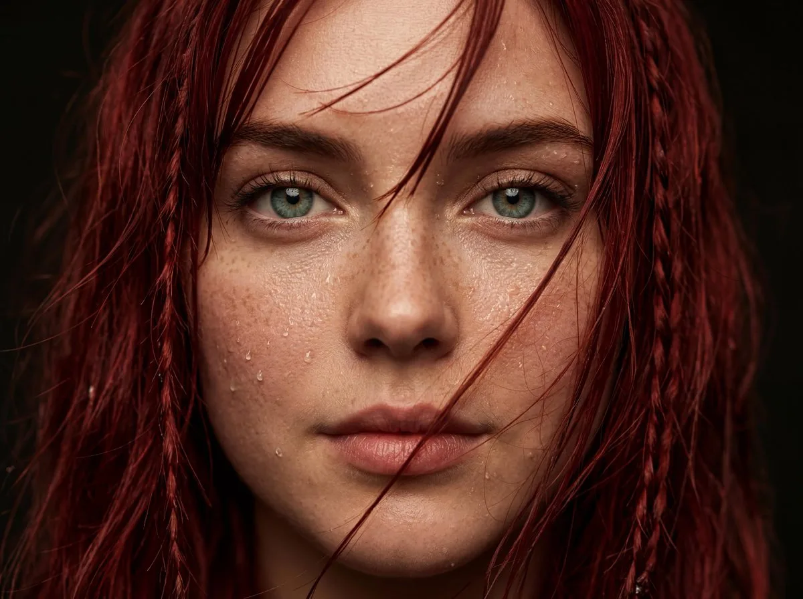

# simeon-sanai — by @Naiknelofar788

[← Back to Examples from X](../../EXAMPLES.md) · Category: Photography · Model: `Nano Banana`

<a href="https://x.com/Naiknelofar788/status/2030925927040037301"></a>

Original post: **[@Naiknelofar788 on X](https://x.com/Naiknelofar788/status/2030925927040037301)** · Creator: [simeon-sanai](https://x.com/Naiknelofar788)

## Prompt

```text
Using the uploaded image as the only reference. create an ultra-photorealistic cinematic close-up portrait of a young woman with vivid red hair and piercing blue-green eyes. Her hair is slightly wet and blown across her face, with delicate braids woven through the strands. Tiny water droplets and natural skin texture glisten across her freckles and cheeks, illuminated by warm dramatic lighting against a dark background.She looks slightly upward with a calm, intense expression, capturing a moment of quiet strength. Emphasize hyper-real skin detail, freckles, wet hair strands, reflective water droplets, and luminous eyes. Shallow depth of field, dramatic contrast, moody cinematic lighting, intimate portrait composition, ultra-detailed textures, 8k photorealism.
```

## Try it

Paste the prompt into **[vinano.ai](https://vinano.ai?utm_source=github&utm_medium=readme&utm_campaign=awesome-image-video-prompts-updating&utm_content=x-page-try)** to generate your own version.

> The image and prompt belong to [@Naiknelofar788](https://x.com/Naiknelofar788) and are shown here with credit for reference. Creators can ask for changes or removal by opening an issue.
