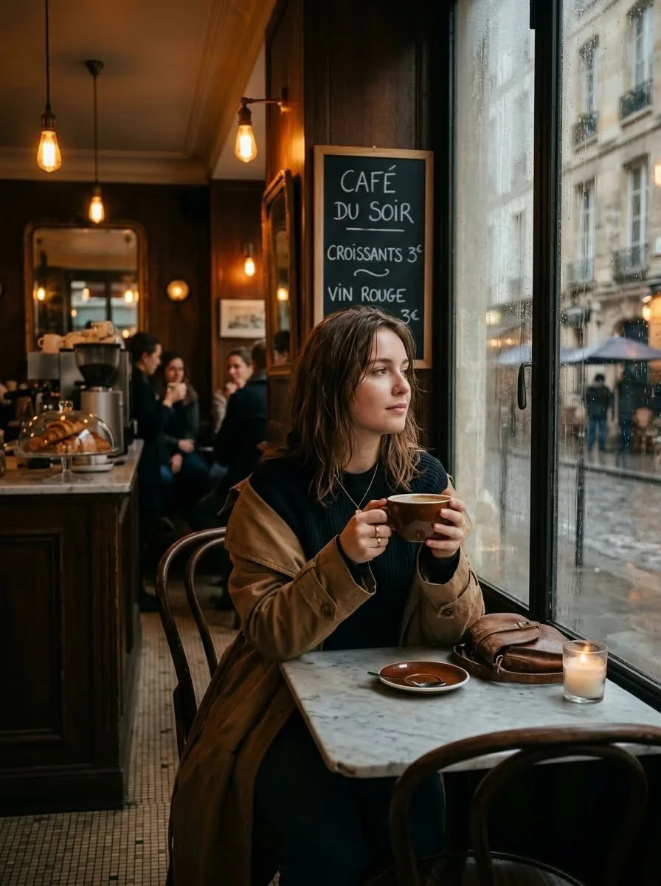

# Kashberg — by @Kashberg_0

[← Back to Community Examples](../../EXAMPLES.md) · Category: Photography · Model: `Nano Banana`

<a href="https://x.com/Kashberg_0/status/2032786956288143858"></a>

Source: **[@Kashberg_0 on X](https://x.com/Kashberg_0/status/2032786956288143858)** · Creator: [Kashberg](https://x.com/Kashberg_0)

## Prompt

```text
Cinematic photo of a young woman sitting alone in a cozy Parisian café on a rainy day, holding a cup of coffee and looking out a large window with raindrops on the glass. Warm vintage café interior with wooden walls, hanging Edison bulbs, marble table, croissants and coffee machine visible in the background. A chalkboard menu reading “Café du Soir, Croissants, Vin Rouge.” Soft natural window light mixed with warm indoor lighting, shallow depth of field, street with umbrellas and classic European buildings outside. Moody, cozy atmosphere, realistic photography, 50mm lens, high detail, cinematic color grading, lifestyle photography, ultra-realistic, 4k.
```

## Try it

Paste the prompt into **[vinano.ai](https://vinano.ai?utm_source=github&utm_medium=readme&utm_campaign=awesome-image-video-prompts-updating&utm_content=x-page-try)** to generate your own version.

> The image and prompt belong to @Kashberg_0 ([original post](https://x.com/Kashberg_0/status/2032786956288143858)) and are shown here with credit for reference. Creators can ask for changes or removal by opening an issue.
