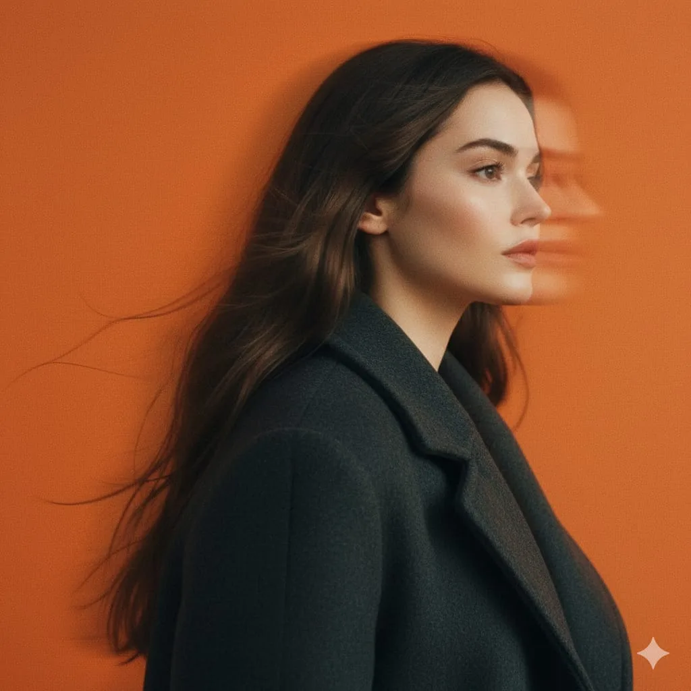

# simply — by @kingofdairyque

[← Back to Examples from X](../../EXAMPLES.md) · Category: Photography · Model: `Nano Banana`

<a href="https://x.com/kingofdairyque/status/2008773580893679871"></a>

Original post: **[@kingofdairyque on X](https://x.com/kingofdairyque/status/2008773580893679871)** · Creator: [simply](https://x.com/kingofdairyque)

## Prompt

```text
A panning studio portrait of a mysterious female figure captured in side profile, her head subtly turned forward as motion blur streaks softly through her hair and jawline. She wears a matte charcoal wool coat with softened edges, standing against a solid Pantone 137 C orange background that fills the frame entirely. The image features intentional horizontal motion blur from a slow shutter pan, preserving facial structure while allowing peripheral smearing. Soft studio lighting with diffused highlights, low contrast, and lifted blacks creates a faded analog film look with fine grain and muted saturation. Shot on a full-frame camera using a 50mm lens at f/2.8, ISO 200, shutter speed 1/15s, vertical orientation, tight portrait framing, shallow depth of field. The mood is cinematic, introspective, and modern editorial visual language aligned with 032c and A24 aesthetics.
```

## Try it

Paste the prompt into **[vinano.ai](https://vinano.ai?utm_source=github&utm_medium=readme&utm_campaign=awesome-image-video-prompts-updating&utm_content=x-page-try)** to generate your own version.

> The image and prompt belong to [@kingofdairyque](https://x.com/kingofdairyque) and are shown here with credit for reference. Creators can ask for changes or removal by opening an issue.
