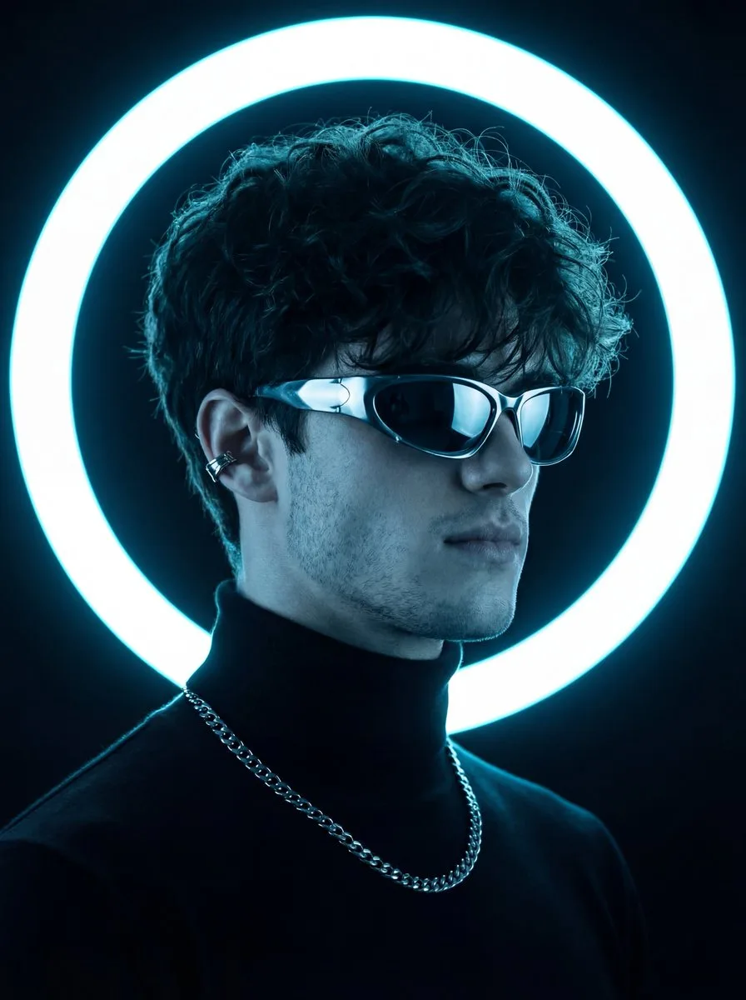

# Harboriis — by @harboriis

[← Back to Community Examples](../../EXAMPLES.md) · Category: Photography · Model: `Nano Banana`

<a href="https://x.com/harboriis/status/2031256944900714553"></a>

Source: **[@harboriis on X](https://x.com/harboriis/status/2031256944900714553)** · Creator: [Harboriis](https://x.com/harboriis)

## Prompt

```text
captured in a dark studio environment with a strong minimalist and futuristic aesthetic. The subject is posed in three-quarter profile, wearing dark clothing such as a black turtleneck and metallic accessories, with reflective sunglasses that catch the ambient light. A circular neon light positioned directly behind the subject creates a luminous halo effect, producing precise rim highlights along the head and shoulders. The lighting is cool and monochromatic, primarily in icy blue tones (-6500K), casting subtle reflections and soft gradients across the matte tex-tures. The background is a deep black (approx. HEX #020509), allowing the neon ring's cyan glow (approx.
```

## Try it

Paste the prompt into **[vinano.ai](https://vinano.ai?utm_source=github&utm_medium=readme&utm_campaign=awesome-image-video-prompts-updating&utm_content=x-page-try)** to generate your own version.

> The image and prompt belong to @harboriis ([original post](https://x.com/harboriis/status/2031256944900714553)) and are shown here with credit for reference. Creators can ask for changes or removal by opening an issue.
