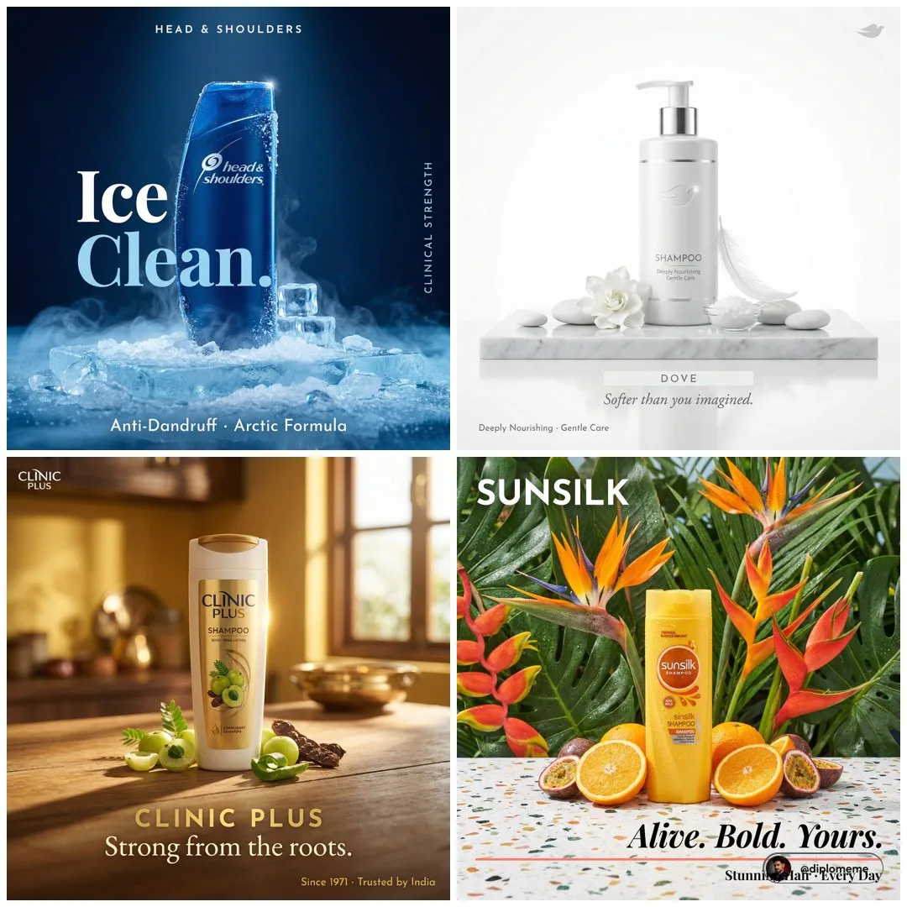

# ᴍᴜʀᴘʜʏ — by @Diplomeme

[← Back to Community Examples](../../EXAMPLES.md) · Category: Product & Brand · Model: `Nano Banana`

<a href="https://x.com/Diplomeme/status/2040831603199672577"></a>

Source: **[@Diplomeme on X](https://x.com/Diplomeme/status/2040831603199672577)** · Creator: [ᴍᴜʀᴘʜʏ](https://x.com/Diplomeme)

## Prompt

```text
Hyper-realistic luxury product campaign poster, 1:1 square format. brand name shampoo bottle standing centered on surface — marble / wood / ice / terrazzo / granite. Background: background — forest bokeh / white infinity / tropical foliage / arctic gradient / violet void. Foreground: ingredients — amla berries / orchid bloom / ice crystals / citrus slices / silk threads scattered naturally around bottle base. Bottle surface hyper-detailed — brand logo catching single overhead spotlight as sharp specular highlight, label color rich and saturated, cap gleaming. Bottle casting natural shadow on surface below, surface reflection of bottle visible beneath.
Fine atmosphere — morning mist / water droplets / dry ice fog / golden dust particles suspended around bottle catching the light. Single hero ingredient — aloe curl / rose petal / keratin oil spill / white gardenia resting against bottle base. Everything arranged as if placed by nature not a stylist.
Typography: top center — “brand name” in 10px Josefin Sans tracked white caps letter-spacing 8px. Center left — large Playfair Display italic stacked headline: “line 1” and “line 2” — 56px white, second line in accent color. Bottom — thin accent color horizontal rule full width. Below rule — “key benefit · key benefit · key benefit” in 8px tracked white caps. Bottom right — “brand tagline” in 9px Cormorant Garamond italic accent color. Right edge vertical — “ingredient · ingredient · ingredient” in 7px white caps rotated 90 degrees.
Lighting: lighting direction — single hard overhead spotlight / soft diffused morning light / cold clinical blue-white / warm golden side light, strong specular on bottle logo and cap, mood light — warm amber fill / cold blue ambient / tropical bright / pure white wrap. Mood: mood — indian home warmth / clinical confidence / tropical joy / salon authority / pure minimalism. Shot on Hasselblad H6D, 85mm anamorphic macro, shallow DOF, palette color bokeh, HDR, luxury haircare campaign, 1:1 square format.
```

## Try it

Paste the prompt into **[vinano.ai](https://vinano.ai?utm_source=github&utm_medium=readme&utm_campaign=awesome-image-video-prompts-updating&utm_content=x-page-try)** to generate your own version.

> The image and prompt belong to @Diplomeme ([original post](https://x.com/Diplomeme/status/2040831603199672577)) and are shown here with credit for reference. Creators can ask for changes or removal by opening an issue.
