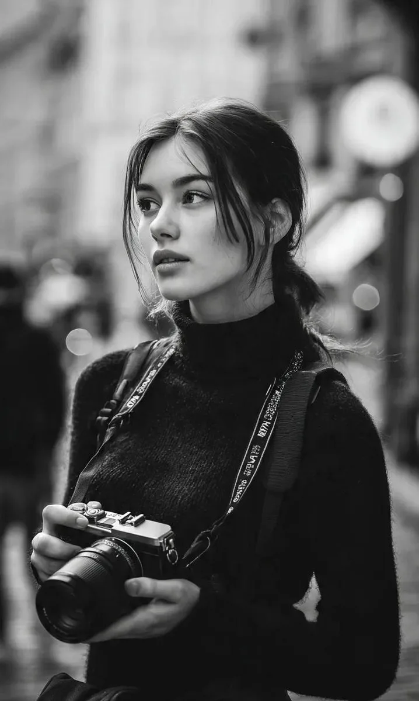

# K — by @ChillaiKalan__

[← Back to Community Examples](../../EXAMPLES.md) · Category: Photography · Model: `Nano Banana`

<a href="https://x.com/ChillaiKalan__/status/2011845501357064442"></a>

Source: **[@ChillaiKalan__ on X](https://x.com/ChillaiKalan__/status/2011845501357064442)** · Creator: [K](https://x.com/ChillaiKalan__)

## Prompt

```text
A cinematic black-and-white street portrait of a young woman photographer standing in a city street, holding a mirrorless camera with both hands. She has soft natural makeup, sharp expressive eyes, and loosely tied dark hair with wisps framing her face. She wears a black turtleneck sweater and a camera strap around her neck. The background is an urban street with blurred pedestrians and lights creating creamy bokeh. Shallow depth of field, 85mm lens look, natural soft light, high contrast monochrome tones, realistic skin texture, candid moment, moody documentary photography style, ultra-detailed, film grain, timeless aesthetic.
```

## Try it

Paste the prompt into **[vinano.ai](https://vinano.ai?utm_source=github&utm_medium=readme&utm_campaign=awesome-image-video-prompts-updating&utm_content=x-page-try)** to generate your own version.

> The image and prompt belong to @ChillaiKalan__ ([original post](https://x.com/ChillaiKalan__/status/2011845501357064442)) and are shown here with credit for reference. Creators can ask for changes or removal by opening an issue.
