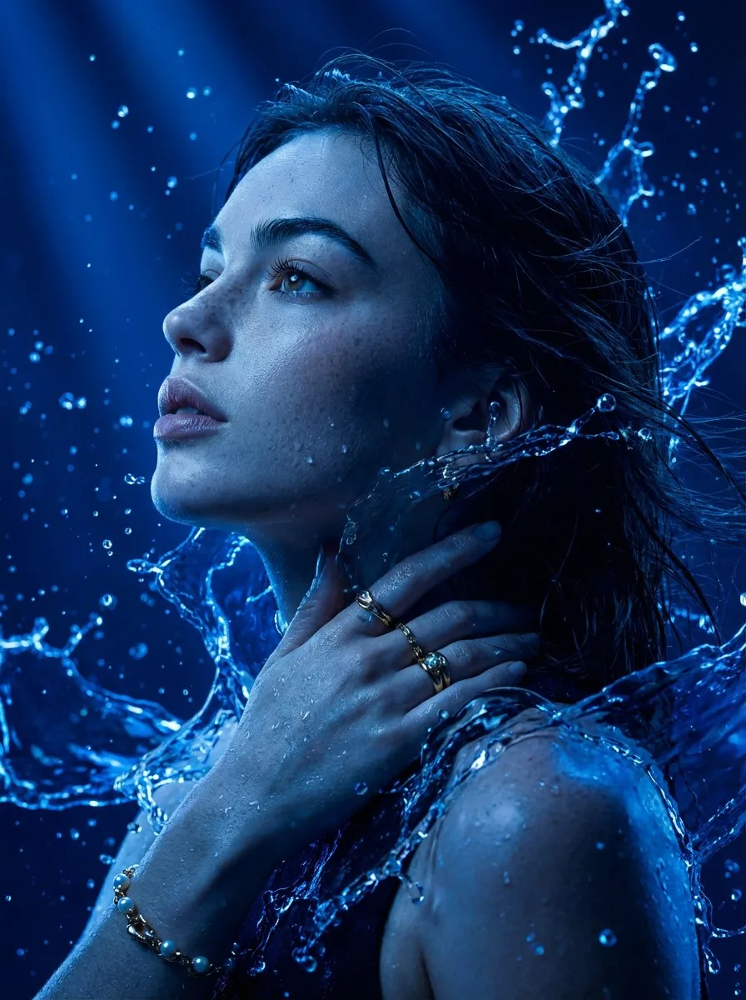

# Aijaz — by @iamsofiaijaz

[← Back to Examples from X](../../EXAMPLES.md) · Category: Photography · Model: `Nano Banana`

<a href="https://x.com/iamsofiaijaz/status/2008181655220154527"></a>

Original post: **[@iamsofiaijaz on X](https://x.com/iamsofiaijaz/status/2008181655220154527)** · Creator: [Aijaz](https://x.com/iamsofiaijaz)

## Prompt

```text
A hyper-detailed cinematic portrait of a human face use selected image for face reference in side profile, looking upward with a calm and powerful expression, the entire subject illuminated in deep electric blue light, water splashes and liquid energy wrapping around the head and shoulders, high contrast, dramatic lighting, ultra-realistic skin texture, fine pores visible, sharp focus, 8K resolution, volumetric lighting, dark blue background, futuristic, ethereal, emotional, digital art, photorealism, high detail.
```

## Try it

Paste the prompt into **[vinano.ai](https://vinano.ai?utm_source=github&utm_medium=readme&utm_campaign=awesome-image-video-prompts-updating&utm_content=x-page-try)** to generate your own version.

> The image and prompt belong to [@iamsofiaijaz](https://x.com/iamsofiaijaz) and are shown here with credit for reference. Creators can ask for changes or removal by opening an issue.
