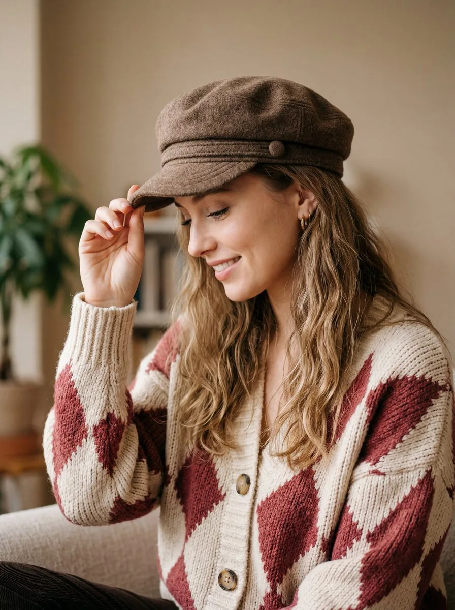

# Heisenberg — by @rovvmut_

[← Back to Examples from X](../../EXAMPLES.md) · Category: Photography · Model: `Nano Banana`

<a href="https://x.com/rovvmut_/status/2037877301455569247"></a>

Original post: **[@rovvmut_ on X](https://x.com/rovvmut_/status/2037877301455569247)** · Creator: [Heisenberg](https://x.com/rovvmut_)

## Prompt

```text
A warm, cozy, and high-quality portrait of a young woman with long, wavy blonde-brown hair, captured in a soft side profile. She is smiling gently and looking downward, her left hand delicately adjusting the brim of a classic brown wool baker boy cap. The cap features a thick, felted texture with a small button nub on top. She is wearing an oversized, chunky knit V-neck cardigan with a bold argyle-style diamond pattern in cream and a muted, deep red. The cardigan features large, visible buttons and a thick ribbed texture along the neckline and cuffs. The background is a soft-focus, neutral beige wall with the blurred green leaves of a plant visible on the far left edge. The lighting is soft and natural, coming from the side to highlight the delicate features of her face and the intricate textures of the knitwear and wool hat. The overall aesthetic is autumnal, serene, and tactile.
```

## Try it

Paste the prompt into **[vinano.ai](https://vinano.ai?utm_source=github&utm_medium=readme&utm_campaign=awesome-image-video-prompts-updating&utm_content=x-page-try)** to generate your own version.

> The image and prompt belong to [@rovvmut_](https://x.com/rovvmut_) and are shown here with credit for reference. Creators can ask for changes or removal by opening an issue.
