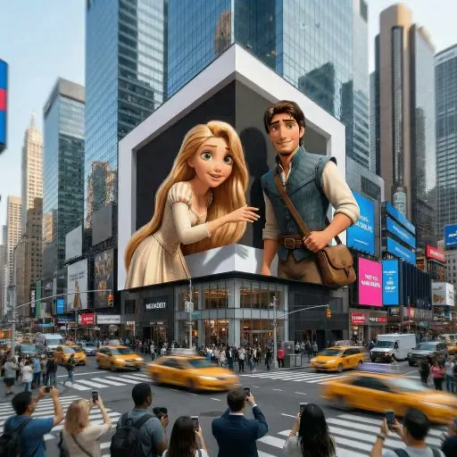

# Sharon Riley — by @Just_sharon7

[← Back to Community Examples](../../EXAMPLES.md) · Category: Illustration & 3D · Model: `Nano Banana`

<a href="https://x.com/Just_sharon7/status/2029508809971118124"></a>

Source: **[@Just_sharon7 on X](https://x.com/Just_sharon7/status/2029508809971118124)** · Creator: [Sharon Riley](https://x.com/Just_sharon7)

## Prompt

```text
{
  "scene": {
    "location": "Busy Western metropolitan intersection, inspired by New York Times Square",
    "architecture": {
      "surroundings": "Modern glass skyscrapers, large digital billboards, clean urban architecture",
      "special_features": [
        "Massive L-shaped naked-eye 3D LED screen on building corner"
      ]
    },
    "lighting": "Daylight from real city environment casting realistic shadows and reflections onto screen edges and nearby buildings",
    "tone": "Premium, editorial, museum-grade, cinematic, grounded, respectful, playful yet premium"
  },
  "characters": [
    {
      "name": "Rapunzel",
      "source": "Tangled",
      "render_style": "High-end cinematic 3D",
      "details": "Faithful to original design, enhanced with ultra-detailed textures, lighting, and depth"
    },
    {
      "name": "Flynn Rider",
      "source": "Tangled",
      "render_style": "High-end cinematic 3D",
      "details": "Faithful to original design, enhanced with ultra-detailed textures, lighting, and depth"
    },
    {
      "name": "Judy Hopps",
      "source": "Zootopia",
      "positioning": "Slightly forward, leaning out of the screen, upper body and ears subtly breaking screen boundary",
      "details": "Alive and expressive, near-photorealistic fur texture and facial expression"
    },
    {
      "name": "Nick Wilde",
      "source": "Zootopia",
      "positioning": "Beside Judy, relaxed posture, half-smiling, tail and shoulder extending into real-world space",
      "details": "Alive and expressive, near-photorealistic fur texture and facial expression"
    }
  ],
  "animation": {
    "style": "Naked-eye 3D, cinematic, polished but not uncanny",
    "purpose": "Hollywood-level outdoor advertising installation designed to stop pedestrians in their tracks",
    "overall_feel": "Playful, premium, cinematic, grounded"
  }
}
```

## Try it

Paste the prompt into **[vinano.ai](https://vinano.ai?utm_source=github&utm_medium=readme&utm_campaign=awesome-image-video-prompts-updating&utm_content=x-page-try)** to generate your own version.

> The image and prompt belong to @Just_sharon7 ([original post](https://x.com/Just_sharon7/status/2029508809971118124)) and are shown here with credit for reference. Creators can ask for changes or removal by opening an issue.
