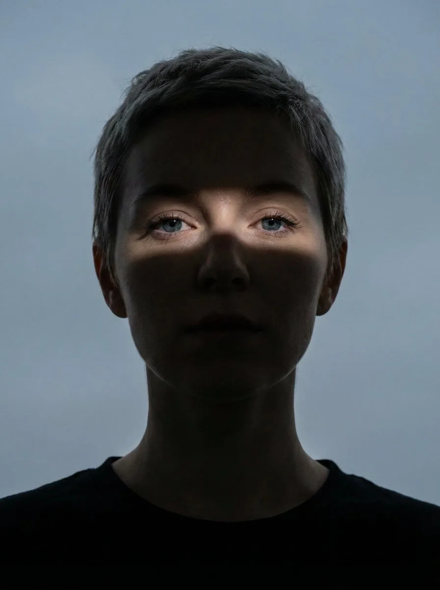

# Oogie — by @oggii_0

[← Back to Examples from X](../../EXAMPLES.md) · Category: Photography · Model: `Nano Banana`

<a href="https://x.com/oggii_0/status/2044775603145224640"></a>

Original post: **[@oggii_0 on X](https://x.com/oggii_0/status/2044775603145224640)** · Creator: [Oogie](https://x.com/oggii_0)

## Prompt

```text
Close-up portrait of a woman (Same face as reference image)looking directly at the camera. Her face and neck are mostly obscured by deep shadow. A single, narrow horizontal band of light cuts across her face, illuminating only her eyes and the bridge of his nose. He has a strong, defined jawline and short, textured hair. She is wearing a simple black shirt. The background is a plain, overcast grayish-blue sky. Dramatic, high-contrast lighting creates a moody, cinematic atmosphere.
```

## Try it

Paste the prompt into **[vinano.ai](https://vinano.ai?utm_source=github&utm_medium=readme&utm_campaign=awesome-image-video-prompts-updating&utm_content=x-page-try)** to generate your own version.

> The image and prompt belong to [@oggii_0](https://x.com/oggii_0) and are shown here with credit for reference. Creators can ask for changes or removal by opening an issue.
