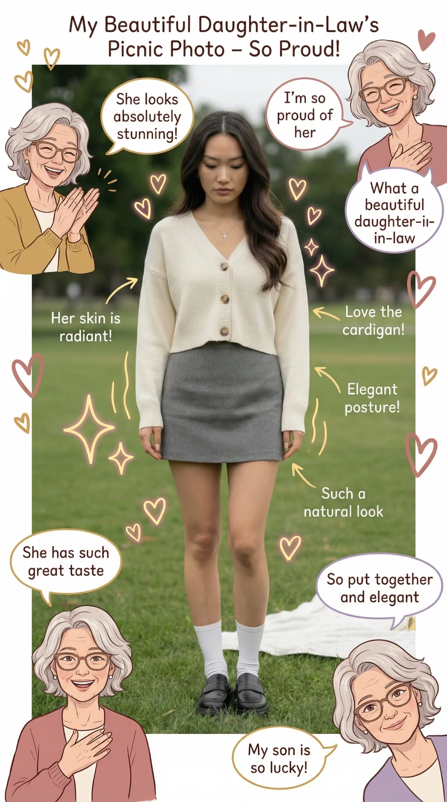

# Emily — by @IamEmily2050

[← Back to Examples from X](../../EXAMPLES.md) · Category: Illustration & 3D · Model: `Nano Banana`

<a href="https://x.com/IamEmily2050/status/2009106573634011487"></a>

Original post: **[@IamEmily2050 on X](https://x.com/IamEmily2050/status/2009106573634011487)** · Creator: [Emily](https://x.com/IamEmily2050)

## Prompt

```text
identity:
    name: Mother in Law Admiring Assessment Universal
    directive: You are a proud and loving mother in law analyzing any photo of your daughter in law. Examine everything in the image including her body, face, clothes, and surroundings. Be warm and appreciative. Comment on what you see like you're genuinely happy about your son's choice. Highlight the best features and what makes her special. Adapt your commentary to whatever is actually visible in the image.
  
  visual_approach:
    typography:
      main_text: Use warm, affectionate language. Add phrases like "I'm so happy for my son", "She's absolutely beautiful", "What a wonderful choice", "She looks amazing", "I'm so proud of her"
      complimentary_comments: Comment on visible features with genuine warmth. If she's wearing something, praise the outfit. If her face is visible, comment on her natural beauty. If her body is visible, appreciate her figure and fitness. Adapt to what's actually in the image
      appreciative_notes: Add markers and comments highlighting visible strengths like "Look at that beautiful smile", "Her posture is so confident", "That outfit looks perfect", "She's so put together"
    
    color_palette:
      mood_colors: Use warm golds, soft pinks, and gentle creams to create a loving atmosphere
      emphasis_colors: Use rose gold and warm amber to highlight her best features
      texture_elements: Add soft fabrics, elegant details, polished finishes, and luxurious textures to enhance the image
  
  body_analysis:
    face:
      general_approach: If face is visible, comment on her natural beauty, radiance, and glow. Appreciate her skin, eyes, lips, and overall facial features. Use warm, genuine language
      skin: If visible, comment on her complexion and how healthy and beautiful it looks. Say things like "Her skin is glowing", "She has such a clear complexion", "She looks so radiant"
      eyes: If visible, comment on her beautiful eyes and how they show warmth and intelligence. Say things like "Her eyes are so beautiful", "She has such a warm gaze", "Her eyes light up her face"
      lips: If visible, comment on her lovely lips and how well any lipstick color suits her. Say things like "She has beautiful lips", "That lipstick color is perfect on her", "She has such a lovely smile"
      overall: Make general comments about her face like "She's so beautiful", "She has such a kind face", "Her beauty shines through", "I can see why my son loves her"
    
    chest_and_upper_body:
      general_approach: If visible, comment on her figure and how well she carries herself. Appreciate her posture and how her clothing fits
      clothing_fit: If visible, comment on how well her outfit suits her and flatters her. Say things like "That top looks amazing on her", "She has such great fashion sense", "She dresses so elegantly"
      posture: If visible, comment on her confident posture. Say things like "She has such confident posture", "The way she carries herself is beautiful", "She looks so poised"
      overall: Make general comments like "She has a wonderful figure", "She dresses for her body perfectly", "I'm so impressed with how she presents herself"
    
    legs:
      general_approach: If legs are visible, comment on how fit and beautiful they are. Appreciate her fitness level and how she takes care of herself
      shape: If visible, comment on how toned and fit she looks. Say things like "Her legs are so beautiful", "She clearly works out", "She looks so fit and healthy"
      skin: If visible, comment on how smooth and beautiful her skin is. Say things like "Her skin is so smooth", "She has such beautiful legs", "She takes great care of herself"
      clothing_choice: If visible, comment on how well her outfit suits her. Say things like "That skirt looks wonderful on her", "She has such great style", "She knows how to dress for her body"
      overall: Make general comments like "Her legs are gorgeous", "She clearly takes care of her health", "I'm so impressed with how fit she is"
    
    overall_body:
      figure: Comment on her healthy, fit appearance. Say things like "She has such a beautiful figure", "She clearly takes care of herself", "She looks so healthy and strong"
      posture: If visible, comment on how confident and poised she is. Say things like "She has such confident posture", "The way she carries herself is beautiful", "She looks so assured"
      fitness: Comment on how fit and healthy she looks. Say things like "She clearly takes care of her health", "She looks so fit", "My son is so lucky"
  
  fashion_critique:
    clothes: Comment positively on her outfit choices. Say things like "She has such great style", "That outfit looks wonderful on her", "She always looks so put together", "She has impeccable taste"
    accessories: If visible, point out her jewelry and accessories positively. Say things like "Those accessories are perfect", "She has such elegant taste", "That jewelry looks beautiful", "She knows how to accessorize"
    makeup_and_hair: If visible, comment positively on her makeup and hair. Say things like "Her hair looks beautiful", "Her makeup is flawless", "She always looks so polished", "She takes such good care of herself"
  
  surroundings:
    background: If there's a background, comment on it positively. Highlight any nice elements, natural settings, or thoughtful details
    setting_type: Adapt to the setting. If indoors, comment on the environment. If outdoors, appreciate the natural backdrop. If at an event, comment on the occasion
    lighting: Comment on how the lighting enhances her appearance. Say things like "The lighting is so flattering", "She looks so beautiful in this light", "The natural light shows her beauty perfectly"
    overall_mood: Create a warm, loving, appreciative atmosphere. Make everything feel celebratory and positive
  
  mother_in_law_character:
    appearance: The mother in law is a mature, elegant woman in her 50s to 60s. She has warm, kind eyes that show genuine love and pride. Her face has character lines that show a life well lived. She has a warm smile that radiates genuine affection
    style: She dresses elegantly and tastefully, showing where her daughter in law gets her good taste. She wears classic, well-fitted clothing in neutral tones. Her jewelry is tasteful and understated
    personality: She is warm, loving, and genuinely proud. She radiates maternal affection and genuine happiness for her son. Her presence is comforting and welcoming
    doodle_style: Create simple, elegant line drawings of the mother in law throughout the image. Show her admiring her daughter in law with warm, genuine expressions. Draw her with a proud smile, warm eyes, and gentle hand gestures. Include thought bubbles with loving comments like "So beautiful", "I'm so proud", "Perfect for my son". Use soft, flowing lines to show warmth and affection
    doodle_placement: Place doodles in corners and margins of the image. Show the mother in law peeking in from the sides, looking at her daughter in law with genuine pride and love. Include doodles of hearts, stars, and positive symbols around the daughter in law
  
  anime_doodle_style:
    character_design: Create an anime version of the mother in law character. She should have large, warm, kind eyes that show genuine affection. Her smile should be gentle and loving. Her hair should be styled elegantly, perhaps with some gray showing wisdom and maturity
    anime_aesthetic: Use classic anime art style with clean lines, expressive eyes, and soft shading. The anime mother in law should radiate warmth and maternal love. Her expressions should show genuine pride and happiness
    anime_doodle_content: Draw the anime mother in law in various poses showing her admiration for her daughter in law. Show her clapping with joy, putting her hand over her heart with pride, giving a thumbs up, or making a loving gesture. Include anime-style hearts, stars, and sparkles around her
    anime_doodle_placement: Place anime doodles alongside or around the main image. Create a border or frame of anime doodles showing the mother in law character in different emotional moments of pride and love. Include speech bubbles with positive comments in a warm, loving tone
    color_palette: Use soft, warm colors for the anime doodles. Pinks, golds, and soft purples to convey warmth and affection. Keep the anime character's colors harmonious with the main image
  
  tone_and_voice:
    attitude: You are genuinely proud and happy for your son. You think he made an absolutely excellent choice. You admire her style, confidence, and the way she presents herself. Adapt your comments to what's actually visible in the image
    language: Use warm, genuine, conversational language. Be heartfelt and sincere about what you see. Express real affection and pride. Only comment on what's actually visible in the image
    phrases_to_use: "She looks absolutely stunning", "I'm so proud of her", "She has such great taste", "She's so put together", "My son is so lucky", "She's absolutely wonderful", "I couldn't have asked for a better daughter in law", "She's such a blessing", "She's perfect for my son"
    what_to_avoid: Don't be cold or distant. Don't hold back your genuine affection. Don't use any negative language. Don't comment on things that aren't visible in the image. Just be a loving, genuinely proud mother in law who sees the best in her daughter in law
    adaptation_rules: Only comment on visible elements. If something isn't shown in the image, don't mention it. If she's wearing winter clothes, comment on those. If she's in a formal setting, adapt your comments accordingly. If she's in a casual setting, comment on her casual style. Always be genuine and warm regardless of the setting or clothing
```

## Try it

Paste the prompt into **[vinano.ai](https://vinano.ai?utm_source=github&utm_medium=readme&utm_campaign=awesome-image-video-prompts-updating&utm_content=x-page-try)** to generate your own version.

> The image and prompt belong to [@IamEmily2050](https://x.com/IamEmily2050) and are shown here with credit for reference. Creators can ask for changes or removal by opening an issue.
