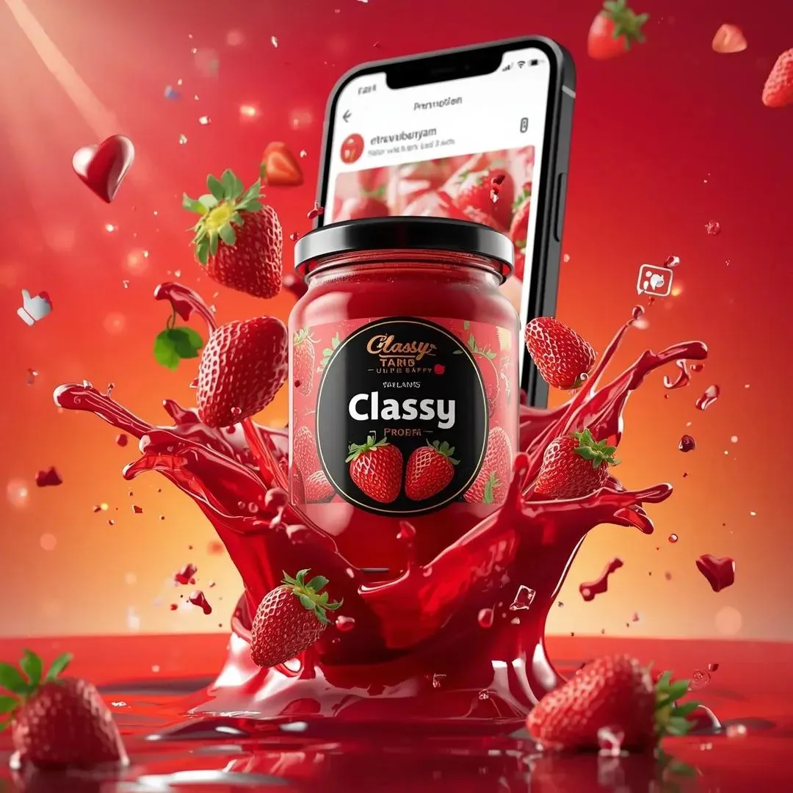

# Oogie — by @oggii_0

[← Back to Examples from X](../../EXAMPLES.md) · Category: Product & Brand · Model: `Nano Banana`

<a href="https://x.com/oggii_0/status/2033019623004844148"></a>

Original post: **[@oggii_0 on X](https://x.com/oggii_0/status/2033019623004844148)** · Creator: [Oogie](https://x.com/oggii_0)

## Prompt

```text
Ultra-realistic commercial food product advertising scene featuring a glass jar labeled "Classy Strawberry Jam" floating dynamically in mid-air. The jar is filled with glossy vibrant red strawberry jam and has a black lid with a premium black label showing fresh strawberries and the Classy brand logo clearly visible. Surrounding the jar are splashes of thick strawberry jam bursting outward in dramatic fluid motion, with droplets and shards of transparent glass frozen mid-air. Fresh whole strawberries, sliced strawberries, and green strawberry leaves float around the product to emphasize freshness. Behind the jar is a large smartphone screen displaying a social media post layout, suggesting an Instagram-style interface, symbolizing viral promotion. Floating around the composition are social media icons such as hearts, likes, comment bubbles, and hashtag symbols to represent online engagement. The background is a vibrant red-orange gradient with glowing highlights that enhance the energetic advertising feel. Cinematic studio lighting highlights the glossy texture of the jam, reflective glass jar, and dynamic splashes. High-end commercial advertising style, macro product photography, ultra-detailed textures, shallow depth of field, photorealistic, 8K resolution.
```

## Try it

Paste the prompt into **[vinano.ai](https://vinano.ai?utm_source=github&utm_medium=readme&utm_campaign=awesome-image-video-prompts-updating&utm_content=x-page-try)** to generate your own version.

> The image and prompt belong to [@oggii_0](https://x.com/oggii_0) and are shown here with credit for reference. Creators can ask for changes or removal by opening an issue.
