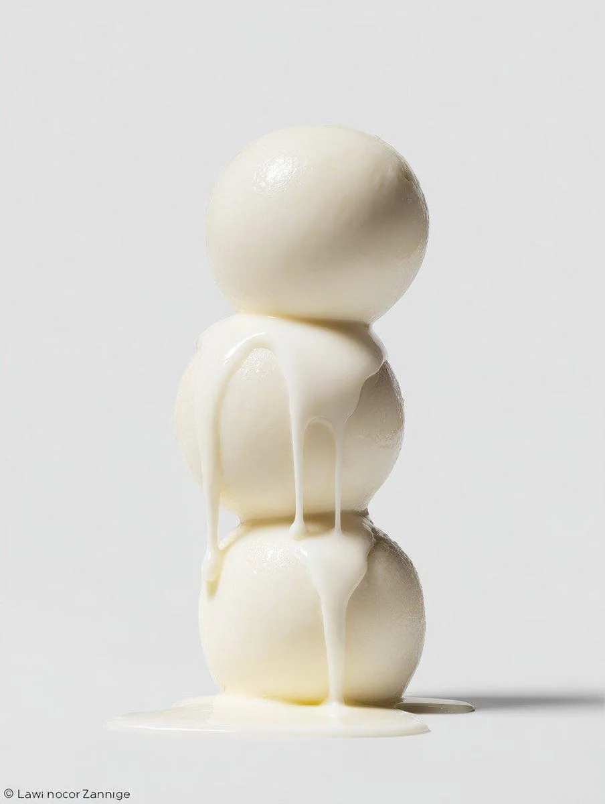

# Oogie — by @oggii_0

[← Back to Examples from X](../../EXAMPLES.md) · Category: Food & Drink · Model: `Nano Banana`

<a href="https://x.com/oggii_0/status/2011829870893125708"></a>

Original post: **[@oggii_0 on X](https://x.com/oggii_0/status/2011829870893125708)** · Creator: [Oogie](https://x.com/oggii_0)

## Prompt

```text
a stack of three [FOOD ITEM] with [LIQUID] dripping down, on a white background, in the style of food photography, magazine cover "[FOOD] pixel", macro shot, studio lighting, nikon z6 ii, volumetric lighting, neutral tones. https://t.co/Op9uSIyKUr
```

## Try it

Paste the prompt into **[vinano.ai](https://vinano.ai?utm_source=github&utm_medium=readme&utm_campaign=awesome-image-video-prompts-updating&utm_content=x-page-try)** to generate your own version.

> The image and prompt belong to [@oggii_0](https://x.com/oggii_0) and are shown here with credit for reference. Creators can ask for changes or removal by opening an issue.
