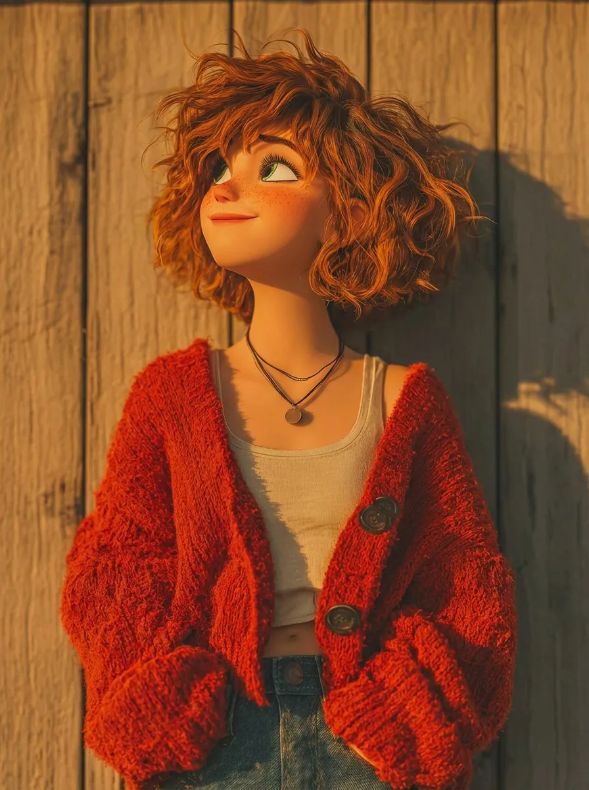

# Aijaz — by @iamsofiaijaz

[← Back to Community Examples](../../EXAMPLES.md) · Category: Illustration & 3D · Model: `Nano Banana`

<a href="https://x.com/iamsofiaijaz/status/2009260113295757750"></a>

Source: **[@iamsofiaijaz on X](https://x.com/iamsofiaijaz/status/2009260113295757750)** · Creator: [Aijaz](https://x.com/iamsofiaijaz)

## Prompt

```text
1. A stylized 3D animated girl with short messy curly ginger hair, light freckles across her cheeks and nose, soft green eyes, warm friendly smile, wearing an oversized textured red knitted cardigan with large buttons, a beige cropped tank top underneath, and high-waisted blue jeans, layered silver necklaces, standing in front of a rustic wooden wall, golden hour warm sunlight casting soft shadows, cinematic lighting, shallow depth of field, Pixar-style character design, ultra detailed, soft skin shading, high quality 3D render, warm color palette, cozy autumn vibe. 

2. A whimsical 3D animated-style portrait of a young child with short, messy, curly brown hair and light freckles, wearing an oversized knitted red cardigan over a simple shirt and denim overalls, leaning gently against a rustic wooden wall. The child is gazing upward with a soft, hopeful smile. Warm golden autumn light, shallow depth of field, cinematic lighting, cozy atmosphere, highly detailed textures, soft skin shading, Pixar-style but original character, ultra high resolution, 85mm lens look, bokeh background, warm color palette, dreamy mood.
```

## Try it

Paste the prompt into **[vinano.ai](https://vinano.ai?utm_source=github&utm_medium=readme&utm_campaign=awesome-image-video-prompts-updating&utm_content=x-page-try)** to generate your own version.

> The image and prompt belong to @iamsofiaijaz ([original post](https://x.com/iamsofiaijaz/status/2009260113295757750)) and are shown here with credit for reference. Creators can ask for changes or removal by opening an issue.
