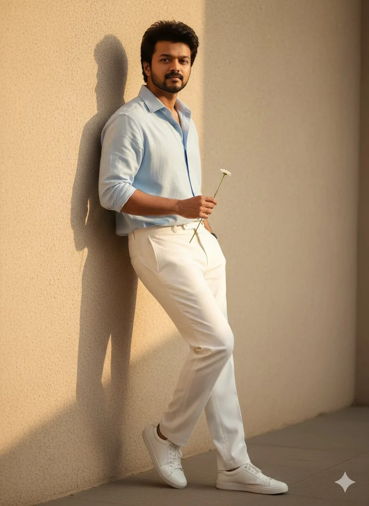

# ராஜேஷ் — by @r4jjesh

[← Back to Examples from X](../../EXAMPLES.md) · Category: Photography · Model: `Nano Banana`

<a href="https://x.com/r4jjesh/status/2011420581695242358"></a>

Original post: **[@r4jjesh on X](https://x.com/r4jjesh/status/2011420581695242358)** · Creator: [ராஜேஷ்](https://x.com/r4jjesh)

## Prompt

```text
{
  "prompt": "Using the uploaded reference image of a 30-year-old adult, generate a highly realistic cinematic fashion editorial photoshoot. The person is leaning casually against a beige textured wall, body slightly angled, one shoulder resting on the wall, conveying relaxed confidence.\n\nOutfit: a loose pastel blue button-down shirt with casually rolled-up sleeves, tailored white relaxed-fit trousers, and clean minimalist white or blue-white sneakers. Styling is modern, elegant, and effortless.\n\nPose & expression: stylish adult pose with natural posture — one hand in pocket, the other holding a small white daisy flower. Facial expression is calm, confident, and self-assured, with a soft editorial gaze.\n\nLighting & atmosphere: warm natural sunlight streaming from the side, creating soft highlights and gentle shadows on the wall and face. Sunlit, airy mood with cinematic depth.\n\nVisual style: high-end fashion editorial aesthetic, natural skin texture, crisp fabric details, refined neutral color palette.\n\nCamera & quality: professional fashion photography, shallow depth of field, cinematic framing, ultra-realistic 8K quality.\n\nOverall feel: modern, minimal, sunlit lifestyle fashion campaign.",
  "style": "cinematic, high-end adult fashion editorial",
  "lighting": "warm natural sunlight, soft shadows",
  "background": "minimal beige wall, sunlit texture",
  "quality": "ultra-realistic, 8K, ultra-sharp",
  "camera": "professional fashion photography, shallow depth of field",
  "mood": "clean, modern, confident, relaxed"
}
```

## Try it

Paste the prompt into **[vinano.ai](https://vinano.ai?utm_source=github&utm_medium=readme&utm_campaign=awesome-image-video-prompts-updating&utm_content=x-page-try)** to generate your own version.

> The image and prompt belong to [@r4jjesh](https://x.com/r4jjesh) and are shown here with credit for reference. Creators can ask for changes or removal by opening an issue.
