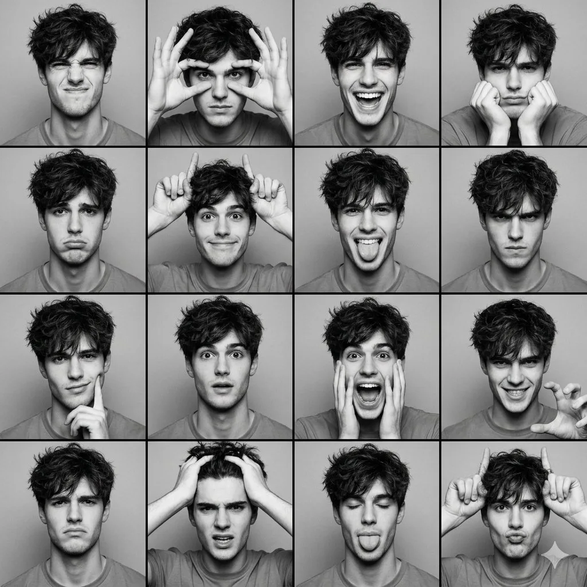

# Harboriis — by @harboriis

[← Back to Examples from X](../../EXAMPLES.md) · Category: Photography · Model: `Nano Banana`

<a href="https://x.com/harboriis/status/2032434291645497698"></a>

Original post: **[@harboriis on X](https://x.com/harboriis/status/2032434291645497698)** · Creator: [Harboriis](https://x.com/harboriis)

## Prompt

```text
{
  "generation_request": {
    "meta_data": {
      "task_type": "black_and_white_photobooth_expression_grid_4x4",
      "language": "en",
      "priority": "highest",
      "version": "v1.0_BW_PHOTOBOOTH_EXPRESSIONS_4X4"
    },
    "input": {
      "mode": "image_to_image",
      "reference_image_usage": "very_high",
      "preserve_identity": true,
      "preserve_facial_features": true,
      "preserve_hairstyle": true,
      "notes": "Use the reference as the primary anchor. Create a black-and-white photobooth-style expression grid. Keep the same young man identity and hair. Each panel should show a different facial expression. Minimal background, direct photobooth flash look, natural skin texture."
    },
    "output": {
      "aspect_ratio": "1:1",
      "resolution": "ultra_high",
      "num_images": 1,
      "layout": {
        "type": "grid",
        "rows": 4,
        "cols": 4,
        "gutter": "thin",
        "panel_consistency": "high"
      },
      "sharpness": "crisp_photobooth",
      "grain": "subtle_analog_bw"
    },
    "scene": {
      "concept": "classic photobooth contact sheet with expressive faces",
      "environment": "plain neutral backdrop, no props",
      "lighting": {
        "style": "direct photobooth flash",
        "key_light": "front flash, slightly hard but flattering",
        "shadows": "soft short shadows behind subject",
        "avoid": "cinematic side light, dramatic backgrounds"
      },
      "camera": {
        "lens": "50mm",
        "distance": "tight head-and-shoulders framing",
        "focus": "eyes sharp in every panel"
      }
    },
    "subject": {
      "type": "young man",
      "wardrobe": "simple casual photobooth look, plain t shirt or hoodie with no logos",
      "hair": "keep same hairstyle across all panels",
      "facial_hair": "natural if present, keep consistent",
      "anatomy_rules": "correct facial proportions, no warped eyes or mouth"
    },
    "expression_set": {
      "panel_01": "scrunched smile, eyes squeezed slightly",
      "panel_02": "intense stare with fingers framing eyes",
      "panel_03": "big laugh, mouth open, joyful",
      "panel_04": "bored unimpressed face, chin resting in hands",
      "panel_05": "sad pout, emotional expression",
      "panel_06": "goofy face with both hands making small horns above head",
      "panel_07": "playful tongue out with cheeky grin",
      "panel_08": "angry glare with eyebrows down",
      "panel_09": "confident playful look, hand touching cheek",
      "panel_10": "surprised wide eyes, mouth slightly open",
      "panel_11": "fake scream excited shout, hands near face",
      "panel_12": "mischievous grin with claw-like hand pose",
      "panel_13": "confused frown with lips pressed",
      "panel_14": "dramatic frustrated expression, hands on head",
      "panel_15": "tongue out with eyes closed, playful mood",
      "panel_16": "duck face with small devil horns gesture"
    },
    "style": {
      "color": "pure black and white",
      "contrast": "medium_high",
      "background": "flat gray",
      "finish": "slight photobooth grain, clean edges"
    },
    "quality_control": {
      "identity_lock": "strict",
      "hands_priority": "high",
      "avoid": [
        "extra fingers",
        "missing fingers",
        "deformed hands",
        "warped face",
        "uneven eyes",
        "melted mouth",
        "plastic skin",
        "text",
        "watermark",
        "logo"
      ]
    },
    "negative_prompt": [
      "color",
      "sepia",
      "overly cinematic lighting",
      "beauty retouch plastic skin",
      "low resolution",
      "blur",
      "distorted anatomy"
    ]
  }
}
```

## Try it

Paste the prompt into **[vinano.ai](https://vinano.ai?utm_source=github&utm_medium=readme&utm_campaign=awesome-image-video-prompts-updating&utm_content=x-page-try)** to generate your own version.

> The image and prompt belong to [@harboriis](https://x.com/harboriis) and are shown here with credit for reference. Creators can ask for changes or removal by opening an issue.
