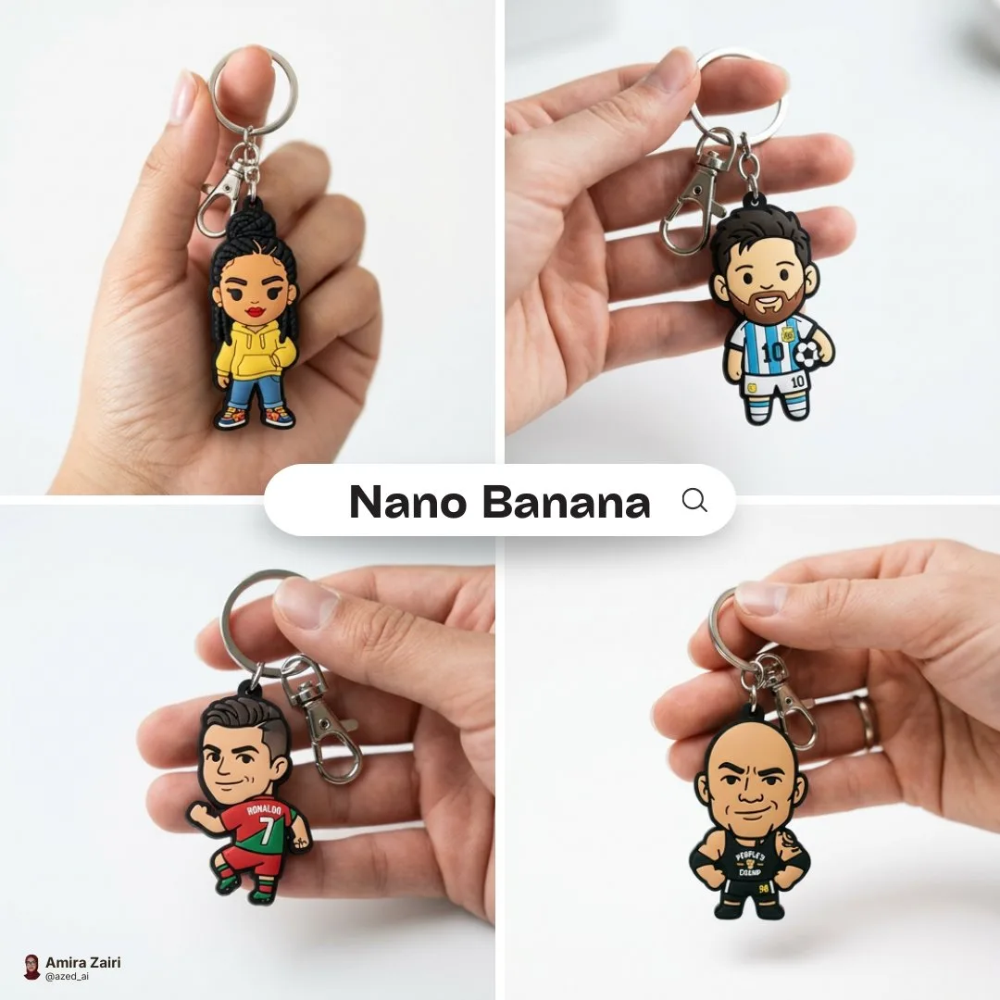

# Amira Zairi — by @azed_ai

[← Back to Examples from X](../../EXAMPLES.md) · Category: Illustration & 3D · Model: `Nano Banana`

<a href="https://x.com/azed_ai/status/2031731136385421407"></a>

Original post: **[@azed_ai on X](https://x.com/azed_ai/status/2031731136385421407)** · Creator: [Amira Zairi](https://x.com/azed_ai)

## Prompt

```text
Close-up photo of a cute, colorful rubber keychain held gently in a person’s hand. The keychain features a chibi-style illustration of [character/person], simplified facial features, rounded proportions, soft pastel color palette, bold thick black outlines, smooth matte rubber texture, slightly raised layered detailing, cartoon expression, compact toy-like silhouette. The keychain is attached to a small silver metal clasp and keyring. Natural hand positioning, shallow depth of field, soft diffused lighting, neutral beige background, realistic skin texture, high-detail product photography, 1:1 aspect ratio.
```

## Try it

Paste the prompt into **[vinano.ai](https://vinano.ai?utm_source=github&utm_medium=readme&utm_campaign=awesome-image-video-prompts-updating&utm_content=x-page-try)** to generate your own version.

> The image and prompt belong to [@azed_ai](https://x.com/azed_ai) and are shown here with credit for reference. Creators can ask for changes or removal by opening an issue.
