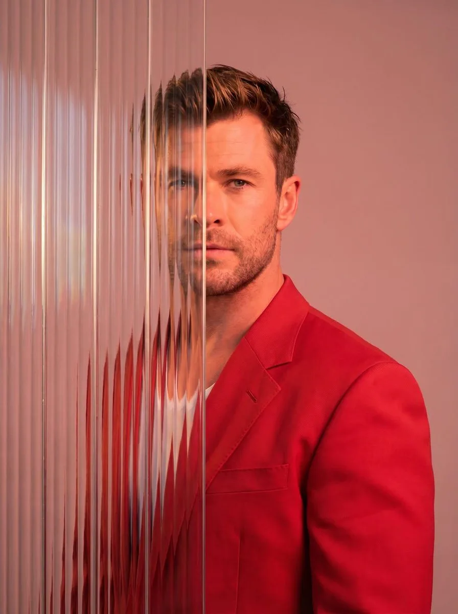

# simeon-sanai — by @Naiknelofar788

[← Back to Examples from X](../../EXAMPLES.md) · Category: Photography · Model: `Nano Banana`

<a href="https://x.com/Naiknelofar788/status/2045689019007426749"></a>

Original post: **[@Naiknelofar788 on X](https://x.com/Naiknelofar788/status/2045689019007426749)** · Creator: [simeon-sanai](https://x.com/Naiknelofar788)

## Prompt

```text
A striking editorial portrait photograph of a person wearing a red blazer, shot against a soft light pink studio background. The left half of the face and body is partially obscured by multiple overlapping vertical strips of tall narrow reeded ribbed frosted glass panels, creating a realistic distortion and refraction effect where the features appear blurred, shifted, and fragmented behind the glass. The right side of the face is clearly visible with sharp detail. Dramatic cool-toned studio lighting with a blue-purple color grade overall. The glass strips run vertically from top to bottom of the frame, covering approximately the left 40 to 50 percent of the image. Serious neutral facial expression. High-fashion editorial style, photorealistic, no text, no watermark, no overlays, clean composition. Vertical portrait orientation, 3:4 ratio.
```

## Try it

Paste the prompt into **[vinano.ai](https://vinano.ai?utm_source=github&utm_medium=readme&utm_campaign=awesome-image-video-prompts-updating&utm_content=x-page-try)** to generate your own version.

> The image and prompt belong to [@Naiknelofar788](https://x.com/Naiknelofar788) and are shown here with credit for reference. Creators can ask for changes or removal by opening an issue.
