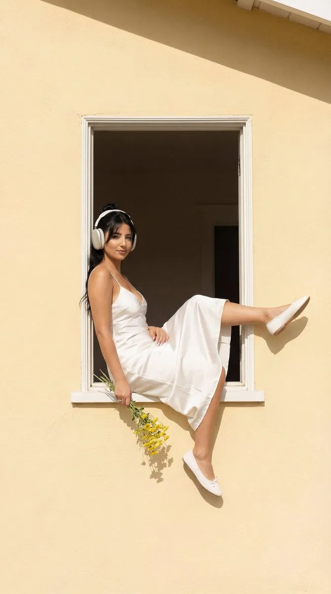

# Özge Döner — by @astronomerozge1

[← Back to Examples from X](../../EXAMPLES.md) · Category: Photography · Model: `Nano Banana`

<a href="https://x.com/astronomerozge1/status/2011519692666470461"></a>

Original post: **[@astronomerozge1 on X](https://x.com/astronomerozge1/status/2011519692666470461)** · Creator: [Özge Döner](https://x.com/astronomerozge1)

## Prompt

```text
{
  "generation_request": {
    "meta_data": {
      "tool": "NanoBanana Pro",
      "task_type": "photoreal_fashion_editorial_window_pose",
      "version": "v1.0_YELLOW_HOUSE_WINDOW_GIRL_WHITE_SATIN",
      "priority": "highest"
    },

    "references": {
      "reference_image_1": {
        "source": "UPLOAD_REFERENCE_IMAGE",
        "purpose": "POSE_AND_COMPOSITION_LOCK",
        "strict_lock": true,
        "match_reference_priority": "MAX",
        "preserve_window_frame": true,
        "preserve_leg_position": true,
        "preserve_body_angle": true,
        "preserve_camera_distance": true,
        "no_style_drift": true
      },
      "reference_image_2": {
        "source": "UPLOAD_FACE_REFERENCE (OPTIONAL)",
        "purpose": "FACE_IDENTITY_LOCK",
        "strict_lock": true,
        "face_similarity_priority": "MAX",
        "no_identity_blending": true,
        "no_beautify": true,
        "no_age_shift": true,
        "preserve_skin_texture": true,
        "preserve_facial_proportions": true
      }
    },

    "creative_direction": {
      "concept": "A playful, editorial fashion moment: a young woman sitting casually inside an open window of a yellow house, one leg lifted outward, captured as a clean, modern lifestyle photograph.",
      "mood": "fresh, carefree, stylish, youthful",
      "style_keywords": "European street style, playful femininity, minimal editorial"
    },

    "scene": {
      "location": "residential exterior",
      "architecture": {
        "house_color": "soft warm yellow facade",
        "window": "simple rectangular window with white interior walls",
        "background": "clean, uncluttered, sunlit wall"
      },
      "time": "midday",
      "lighting": "direct natural sunlight, crisp shadows"
    },

    "subject": {
      "gender": "female",
      "pose": {
        "position": "sitting inside the window frame",
        "legs": "one leg extended outward and raised, the other relaxed",
        "arms": "one arm hanging freely outside the window"
      },
      "expression": "neutral to calm, relaxed confidence",
      "gaze": "looking forward or slightly to the side"
    },

    "wardrobe": {
      "dress": {
        "type": "white satin slip dress",
        "style": "thin straps, minimal, fluid fabric",
        "length": "midi",
        "finish": "soft satin sheen"
      },
      "headphones": {
        "type": "over-ear",
        "color": "pure white",
        "style": "clean, modern, minimal"
      },
      "shoes": {
        "type": "flat or low-heel shoes",
        "color": "white",
        "style": "simple, elegant"
      }
    },

    "accessories": {
      "flowers": {
        "type": "fresh yellow flowers",
        "placement": "held loosely in one hand",
        "look": "natural, slightly wild bouquet"
      }
    },

    "photography": {
      "camera_style": "fashion editorial street photography",
      "lens": "35mm",
      "framing": "centered subject, full body within window frame",
      "depth_of_field": "moderate, background sharp",
      "color_grade": "warm yellows, clean whites, natural skin tones"
    },

    "output_settings": {
      "aspect_ratio": "4:5",
      "orientation": "portrait",
      "resolution_target": "ultra_high_res",
      "render_style": "ultra_photoreal_editorial",
      "sharpness": "clean_and_crisp",
      "dynamic_range": "natural_not_hdr",
      "no_text": true,
      "no_watermark": true,
      "no_logo": true
    },

    "quality_controls": {
      "anatomy": {
        "no_deformed_limbs": true,
        "no_extra_fingers": true
      },
      "fabric": {
        "satin_reads_real": true
      },
      "coherence": {
        "wardrobe_consistent": true,
        "pose_identical_to_reference": true
      }
    },

    "negative_prompt": [
      "patterned dress",
      "dark or black clothing",
      "headphones not white",
      "boots or dark shoes",
      "busy background",
      "cartoon, illustration, anime",
      "HDR, oversharpening",
      "text, watermark, logo",
      "deformed anatomy"
    ]
  }
}
```

## Try it

Paste the prompt into **[vinano.ai](https://vinano.ai?utm_source=github&utm_medium=readme&utm_campaign=awesome-image-video-prompts-updating&utm_content=x-page-try)** to generate your own version.

> The image and prompt belong to [@astronomerozge1](https://x.com/astronomerozge1) and are shown here with credit for reference. Creators can ask for changes or removal by opening an issue.
