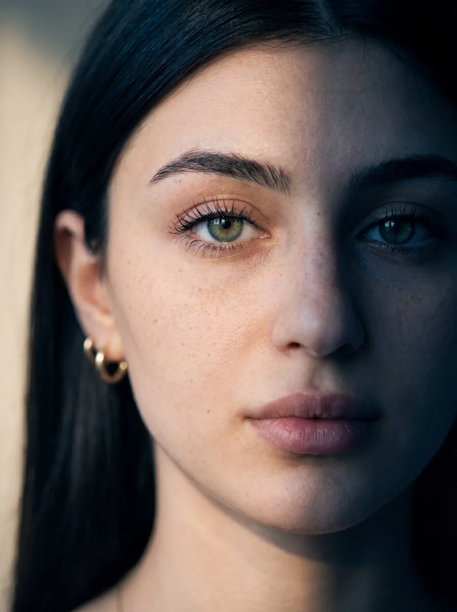

# Kashberg — by @Kashberg_0

[← Back to Community Examples](../../EXAMPLES.md) · Category: Photography · Model: `Nano Banana`

<a href="https://x.com/Kashberg_0/status/2045717144319697140"></a>

Source: **[@Kashberg_0 on X](https://x.com/Kashberg_0/status/2045717144319697140)** · Creator: [Kashberg](https://x.com/Kashberg_0)

## Prompt

```text
Ultra-realistic close-up portrait of a young woman with fair skin and subtle freckles, green eyes, and natural full lips, dark straight hair tucked behind the ear, wearing small gold hoop earrings. Dramatic split lighting across the face — one half illuminated with soft natural light, the other half in deep shadow with cool blue tones. High detail skin texture, sharp focus on eyes and eyelashes, minimal makeup, cinematic lighting, moody atmosphere, shallow depth of field, 85mm lens, f/1.8, photorealistic, editorial beauty photography.
```

## Try it

Paste the prompt into **[vinano.ai](https://vinano.ai?utm_source=github&utm_medium=readme&utm_campaign=awesome-image-video-prompts-updating&utm_content=x-page-try)** to generate your own version.

> The image and prompt belong to @Kashberg_0 ([original post](https://x.com/Kashberg_0/status/2045717144319697140)) and are shown here with credit for reference. Creators can ask for changes or removal by opening an issue.
