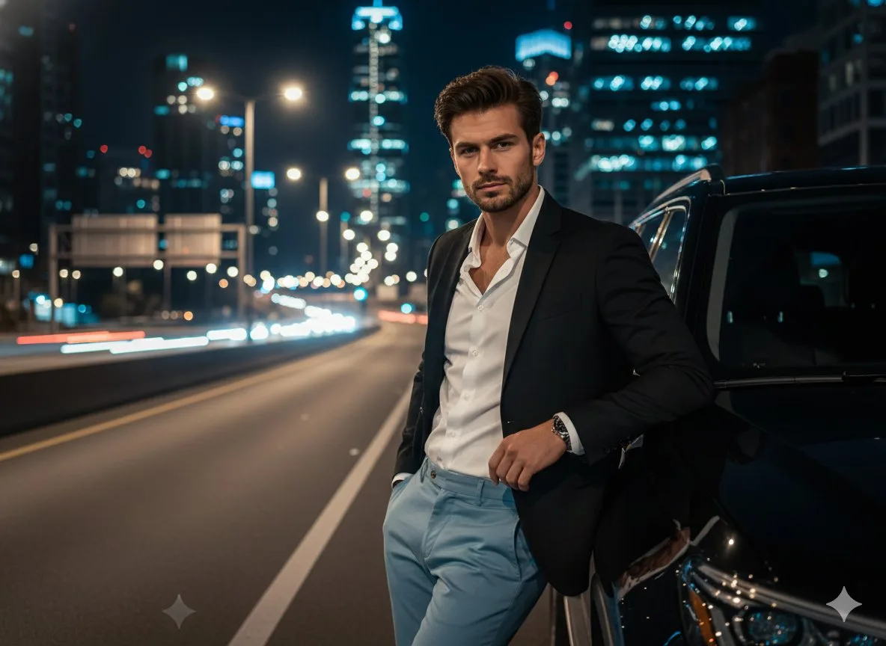

# Kashberg — by @Kashberg_0

[← Back to Community Examples](../../EXAMPLES.md) · Category: Photography · Model: `Nano Banana`

<a href="https://x.com/Kashberg_0/status/2008815653424390145"></a>

Source: **[@Kashberg_0 on X](https://x.com/Kashberg_0/status/2008815653424390145)** · Creator: [Kashberg](https://x.com/Kashberg_0)

## Prompt

```text
A cinematic night-time urban portrait of a confident, handsome man leaning against a black luxury SUV on a modern city highway. He is wearing a black blazer over a white unbuttoned dress shirt and light blue tailored trousers, one hand in his pocket, the other resting on the car. Clean haircut, light stubble, sharp masculine features. Skyscrapers with glowing windows in the background, streetlights creating bokeh, long light trails from passing traffic. Moody, high-contrast lighting, shallow depth of field, professional fashion photography, ultra-realistic, 85mm lens, f/1.8, cinematic color grading, luxury lifestyle aesthetic.
```

## Try it

Paste the prompt into **[vinano.ai](https://vinano.ai?utm_source=github&utm_medium=readme&utm_campaign=awesome-image-video-prompts-updating&utm_content=x-page-try)** to generate your own version.

> The image and prompt belong to @Kashberg_0 ([original post](https://x.com/Kashberg_0/status/2008815653424390145)) and are shown here with credit for reference. Creators can ask for changes or removal by opening an issue.
