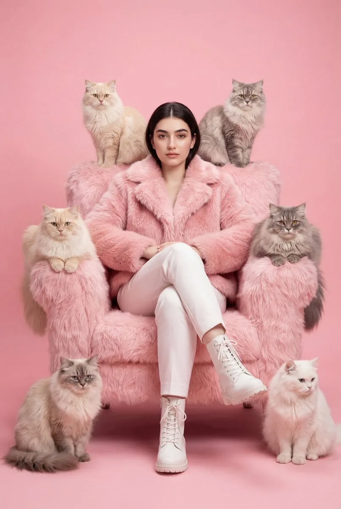

# Zara — by @ZaraIrahh

[← Back to Community Examples](../../EXAMPLES.md) · Category: Photography · Model: `Nano Banana`

<a href="https://x.com/ZaraIrahh/status/2032699901499551793"></a>

Source: **[@ZaraIrahh on X](https://x.com/ZaraIrahh/status/2032699901499551793)** · Creator: [Zara](https://x.com/ZaraIrahh)

## Prompt

```text
Using the uploaded picture as the only reference and without changing the face, create a fashion editorial portrait of a woman sitting confidently in a plush oversized pink faux-fur armchair against a soft pastel pink background; she wears a fluffy pink jacket, white trousers and white lace-up boots, seated with legs crossed and a calm confident expression; surrounded symmetrically by multiple fluffy long-haired cats in cream, gray and white tones perched on the chair arms, backrest and floor around her; highly stylized monochromatic pink aesthetic, soft studio lighting, clean background, luxurious textures in fur fabric and cat fur, centered composition, fashion magazine style, high detail, shallow depth of field, ultra-sharp textures, high dynamic range, 8k ultra-photorealism, masterpiece quality.
```

## Try it

Paste the prompt into **[vinano.ai](https://vinano.ai?utm_source=github&utm_medium=readme&utm_campaign=awesome-image-video-prompts-updating&utm_content=x-page-try)** to generate your own version.

> The image and prompt belong to @ZaraIrahh ([original post](https://x.com/ZaraIrahh/status/2032699901499551793)) and are shown here with credit for reference. Creators can ask for changes or removal by opening an issue.
