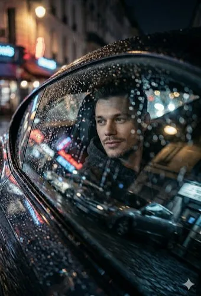

# Minahil — by @Minahil42298354

[← Back to Examples from X](../../EXAMPLES.md) · Category: Photography · Model: `Nano Banana`

<a href="https://x.com/Minahil42298354/status/2039732389979607055"></a>

Original post: **[@Minahil42298354 on X](https://x.com/Minahil42298354/status/2039732389979607055)** · Creator: [Minahil](https://x.com/Minahil42298354)

## Prompt

```text
A low-angle, cinematic close-up shot looking through a rain-slicked car window. Inside the car, a contemplative man with short dark hair and slight stubble is visible, looking out toward the city. The focus is sharp on the water droplets clinging to the glass, while the man and the background are slightly softer.
​Setting & Atmosphere: A bustling European city street at night during a rainstorm. The atmosphere is melancholic yet cozy. In the reflection of the car door and window, blurred city lights, glowing neon shop signs (blues and reds), and the outlines of historical architecture are visible.
​Lighting & Color: * Lighting: Naturalistic night lighting provided by street lamps and neon signs, creating a cool blue and teal base with warm orange and red highlights.
​Reflections: Complex reflections of wet pavement and passing cars on the dark metallic surface of the vehicle.
​Technical Specs: 35mm lens, f/1.8 aperture for shallow depth of field, high contrast, moody film grain, hyper-realistic textures, shot on Sony A7R IV style.
```

## Try it

Paste the prompt into **[vinano.ai](https://vinano.ai?utm_source=github&utm_medium=readme&utm_campaign=awesome-image-video-prompts-updating&utm_content=x-page-try)** to generate your own version.

> The image and prompt belong to [@Minahil42298354](https://x.com/Minahil42298354) and are shown here with credit for reference. Creators can ask for changes or removal by opening an issue.
