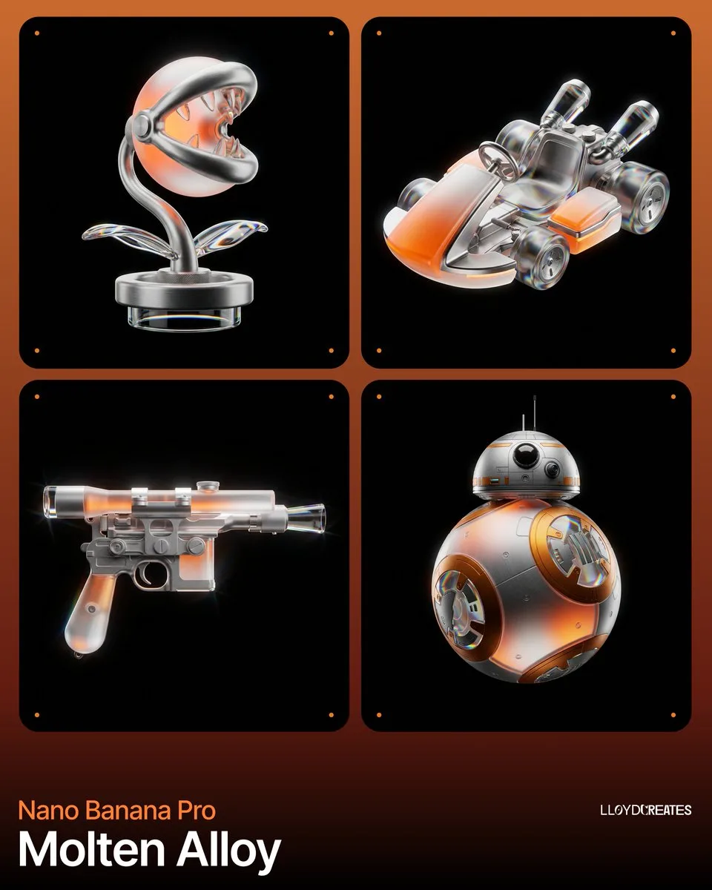

# Lloyd Creates — by @lloydcreates

[← Back to Community Examples](../../EXAMPLES.md) · Category: Illustration & 3D · Model: `Nano Banana`

<a href="https://x.com/lloydcreates/status/2029268041628823967"></a>

Source: **[@lloydcreates on X](https://x.com/lloydcreates/status/2029268041628823967)** · Creator: [Lloyd Creates](https://x.com/lloydcreates)

## Prompt

```text
{
  "image_generation_request": {
    "subject": {
      "placeholder": "[INSERT YOUR PRODUCT HERE]",
      "positioning": "centrally aligned, perfectly centered, levitating in mid-air",
      "framing": "full object visibility, no cropping, no cut-off edges, ample negative space around the product"
    },
    "visual_style": {
      "aesthetic": "ultra-modern industrial design, hyper-realistic product photography, cinematic tech-minimalism",
      "background": {
        "color": "#000000",
        "finish": "pure void, matte black, non-reflective"
      },
      "lighting": {
        "type": "top-down rim lighting, subtle key light",
        "effects": [
          "spectral dispersion",
          "chromatic aberration on glass edges",
          "prismatic light refraction",
          "soft caustic highlights"
        ]
      }
    },
    "materials_and_textures": {
      "primary_blends": [
        "anodized brushed aluminum with micro-circular grain",
        "frosted translucent polycarbonate with internal orange-to-white gradient glow",
        "optically clear glass with rainbow refractive edges",
        "matte sandblasted metallic surfaces"
      ],
      "details": "high-precision CNC machined edges, tactile knurling, smooth organic fillets"
    },
    "constraints": {
      "mandatory_omissions": [
        "no lighting boxes",
        "no softboxes",
        "no tripod stands",
        "no pedestals",
        "no platforms",
        "no props",
        "no text",
        "no watermarks",
        "no human hands",
        "no floor line",
        "no background gradients"
      ],
      "compositional_rules": "The product must be the sole inhabitant of the frame. Ensure zero contact with any surface. Maintain absolute symmetry and 100% black levels for the background environment."
    },
    "color_palette": {
      "background": "#000000",
      "accents": [
        "#FF4500",
        "#FFFFFF",
        "#808080",
        "spectral rainbow/prismatic dispersion"
      ]
    }
  }
}
```

## Try it

Paste the prompt into **[vinano.ai](https://vinano.ai?utm_source=github&utm_medium=readme&utm_campaign=awesome-image-video-prompts-updating&utm_content=x-page-try)** to generate your own version.

> The image and prompt belong to @lloydcreates ([original post](https://x.com/lloydcreates/status/2029268041628823967)) and are shown here with credit for reference. Creators can ask for changes or removal by opening an issue.
