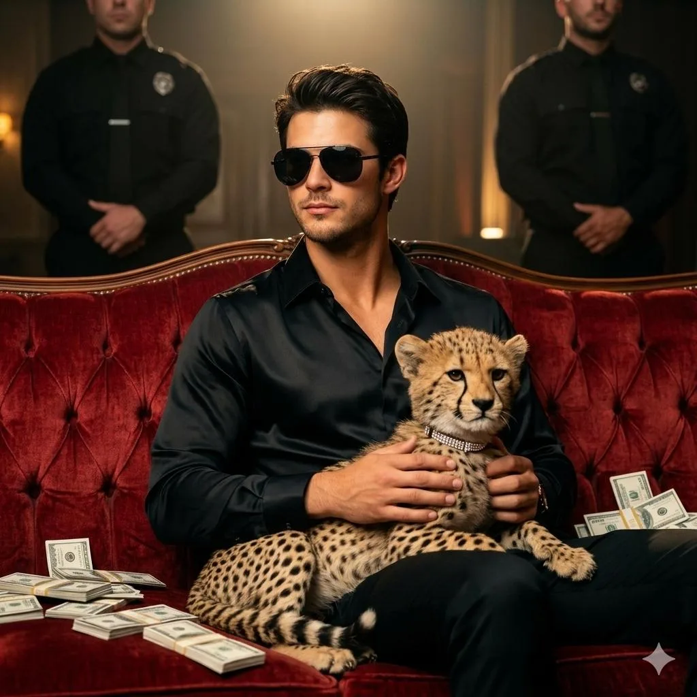

# auqib — by @auqibhabib

[← Back to Community Examples](../../EXAMPLES.md) · Category: Photography · Model: `Nano Banana`

<a href="https://x.com/auqibhabib/status/2029721401033384149"></a>

Source: **[@auqibhabib on X](https://x.com/auqibhabib/status/2029721401033384149)** · Creator: [auqib](https://x.com/auqibhabib)

## Prompt

```text
Using the reference picture, create A stylish man sitting on a luxurious vintage red velvet sofa, wearing black silk shirt, sunglasses, confi-dently holding a cheetah adorned with cinematic lighting, dollars are spread on sofa too and there are two guards on back side in blur bg, luxury life-style, dramatic atmosphere." 100% Real Face 8K Resolution
```

## Try it

Paste the prompt into **[vinano.ai](https://vinano.ai?utm_source=github&utm_medium=readme&utm_campaign=awesome-image-video-prompts-updating&utm_content=x-page-try)** to generate your own version.

> The image and prompt belong to @auqibhabib ([original post](https://x.com/auqibhabib/status/2029721401033384149)) and are shown here with credit for reference. Creators can ask for changes or removal by opening an issue.
