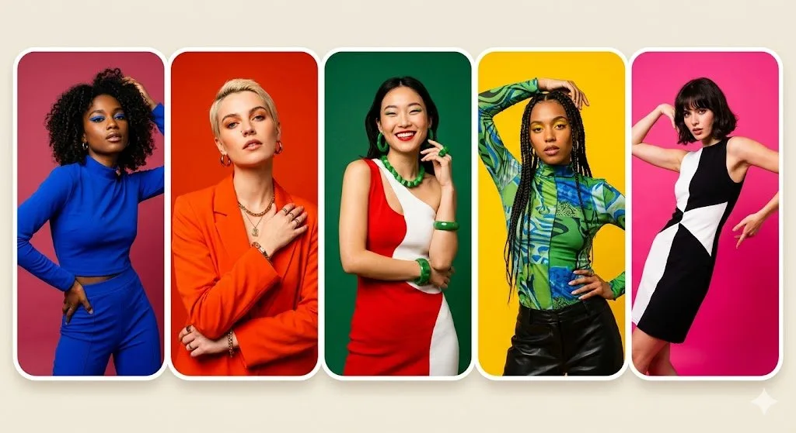

# Cherry 2.O — by @Mind_Boticni

[← Back to Community Examples](../../EXAMPLES.md) · Category: Poster Design · Model: `Nano Banana`

<a href="https://x.com/Mind_Boticni/status/2041126427295461679"></a>

Source: **[@Mind_Boticni on X](https://x.com/Mind_Boticni/status/2041126427295461679)** · Creator: [Cherry 2.O](https://x.com/Mind_Boticni)

## Prompt

```text
5 panel colorful portrait collage, fashion models, monochrome backgrounds (pink, red, green, yellow), vibrant studio lighting, modern editorial style, rounded grid layout, high contrast, minimal shadows
```

## Try it

Paste the prompt into **[vinano.ai](https://vinano.ai?utm_source=github&utm_medium=readme&utm_campaign=awesome-image-video-prompts-updating&utm_content=x-page-try)** to generate your own version.

> The image and prompt belong to @Mind_Boticni ([original post](https://x.com/Mind_Boticni/status/2041126427295461679)) and are shown here with credit for reference. Creators can ask for changes or removal by opening an issue.
