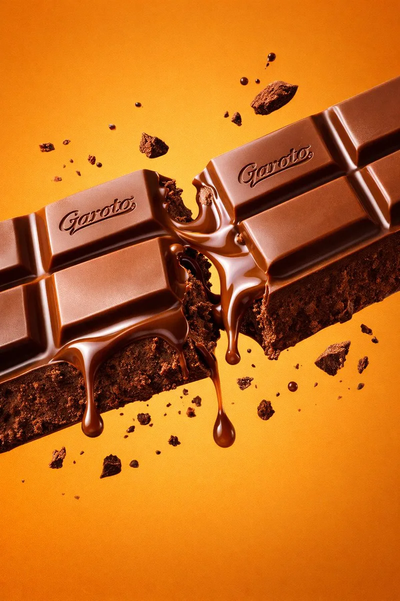

# 𝐌 — by @Strength04_X

[← Back to Community Examples](../../EXAMPLES.md) · Category: Food & Drink · Model: `Nano Banana`

<a href="https://x.com/Strength04_X/status/2013579683686961503"></a>

Source: **[@Strength04_X on X](https://x.com/Strength04_X/status/2013579683686961503)** · Creator: [𝐌](https://x.com/Strength04_X)

## Prompt

```text
Use the uploaded product image as reference. Create an ultra-realistic commercial image of a Garoto chocolate bar. Show a broken bar with melted chocolate texture, visible cocoa details and rich gloss. Add subtle chocolate splashes and floating crumbs. Clean studio setup, vibrant colored background, bold advertising style for social media. 8K ultra realistic, high sharpness, high contrast, professional lighting with realistic shadows and highlights, no text, no watermark, no blur, no distortion, no low quality, no cartoonish style
```

## Try it

Paste the prompt into **[vinano.ai](https://vinano.ai?utm_source=github&utm_medium=readme&utm_campaign=awesome-image-video-prompts-updating&utm_content=x-page-try)** to generate your own version.

> The image and prompt belong to @Strength04_X ([original post](https://x.com/Strength04_X/status/2013579683686961503)) and are shown here with credit for reference. Creators can ask for changes or removal by opening an issue.
