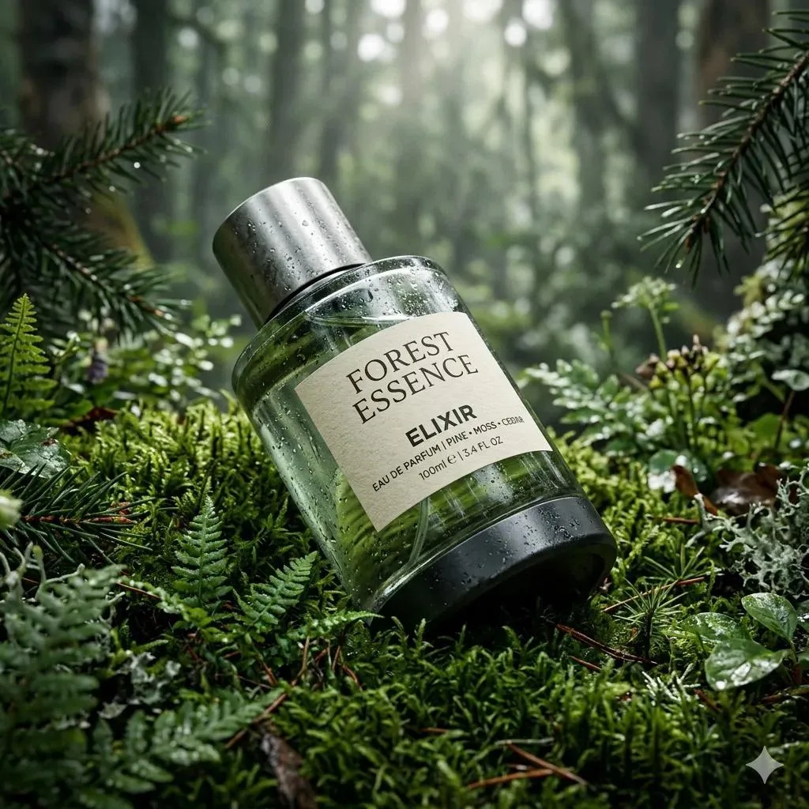

# Oogie — by @oggii_0

[← Back to Examples from X](../../EXAMPLES.md) · Category: Product & Brand · Model: `Nano Banana`

<a href="https://x.com/oggii_0/status/2039312763491917901"></a>

Original post: **[@oggii_0 on X](https://x.com/oggii_0/status/2039312763491917901)** · Creator: [Oogie](https://x.com/oggii_0)

## Prompt

```text
Ultra-realistic premium fragrance product shot of a perfume bottle (Forest Essence Elixir), positioned at a (low macro angled shot) resting diagonally on lush (deep green moss surface in a forest setting), cylindrical design with a transparent glass center revealing green-tinted liquid, textured (matte black base) and brushed (metallic silver cap) with visible condensation droplets, surrounded by dense (forest foliage and pine branches) softly framing the scene, subtle (morning mist
```

## Try it

Paste the prompt into **[vinano.ai](https://vinano.ai?utm_source=github&utm_medium=readme&utm_campaign=awesome-image-video-prompts-updating&utm_content=x-page-try)** to generate your own version.

> The image and prompt belong to [@oggii_0](https://x.com/oggii_0) and are shown here with credit for reference. Creators can ask for changes or removal by opening an issue.
