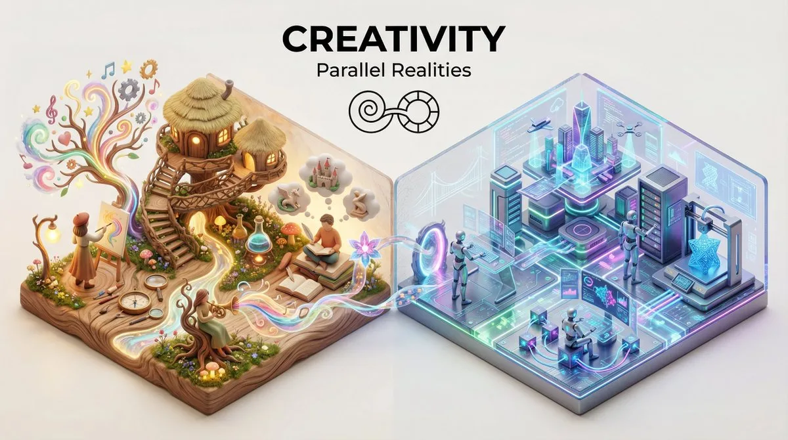

# Aleena Amir — by @aleenaamiir

[← Back to Examples from X](../../EXAMPLES.md) · Category: Illustration & 3D · Model: `Nano Banana`

<a href="https://x.com/aleenaamiir/status/2017820238314934756"></a>

Original post: **[@aleenaamiir on X](https://x.com/aleenaamiir/status/2017820238314934756)** · Creator: [Aleena Amir](https://x.com/aleenaamiir)

## Prompt

```text
“Present a clear, 45° top-down isometric miniature 3D split diorama showing two parallel worlds of [THEME]: [WORLD A] vs [WORLD B].

Use soft refined textures, realistic PBR materials, and contrasting lighting styles for each side.

Design a single raised base divided down the center with mirrored layouts and subtle crossover details.

Include tiny stylized characters existing differently in each world (no facial details).

Use a clean solid [BACKGROUND COLOR] background.

At the top-center, display [THEME NAME] in large bold text, beneath it show ‘Parallel Realities’, and place a minimal abstract icon below.

All text must automatically match the background contrast (white or black).”
```

## Try it

Paste the prompt into **[vinano.ai](https://vinano.ai?utm_source=github&utm_medium=readme&utm_campaign=awesome-image-video-prompts-updating&utm_content=x-page-try)** to generate your own version.

> The image and prompt belong to [@aleenaamiir](https://x.com/aleenaamiir) and are shown here with credit for reference. Creators can ask for changes or removal by opening an issue.
